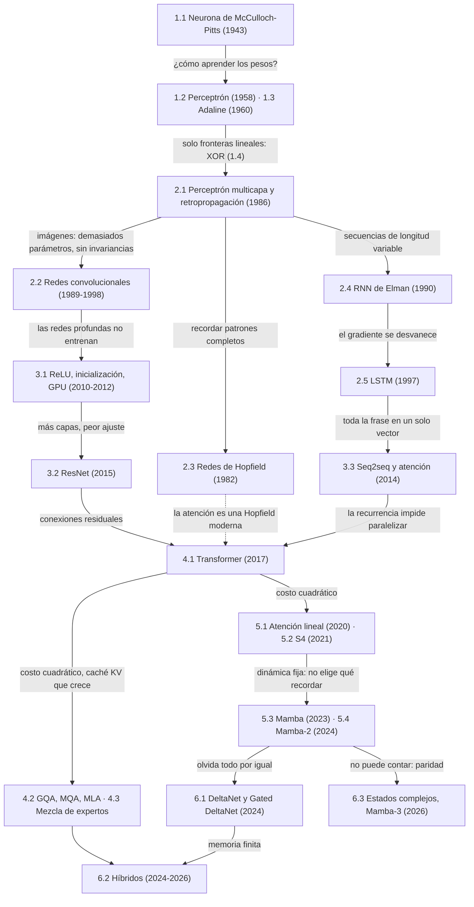
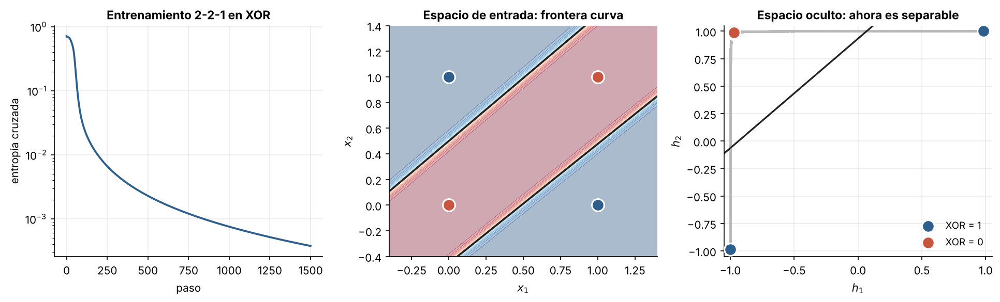
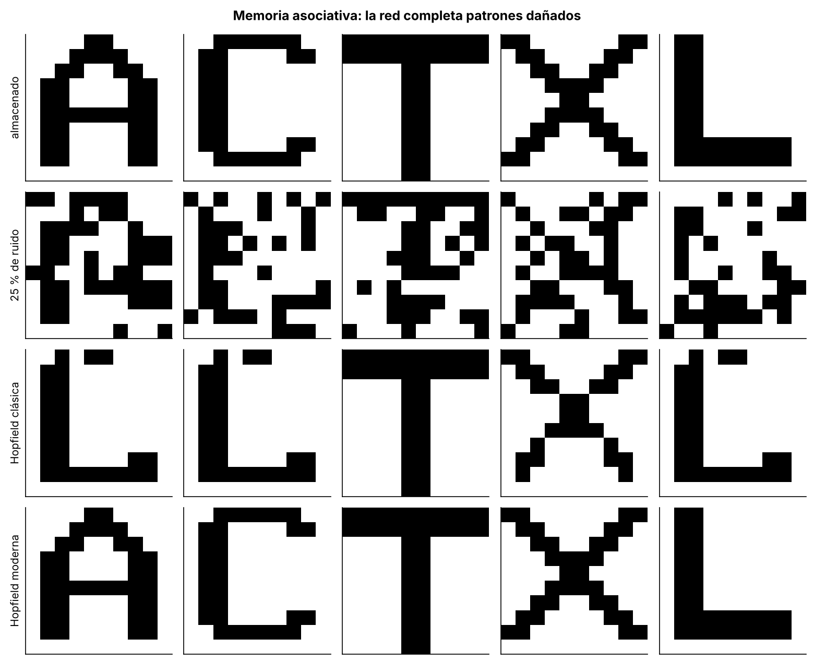
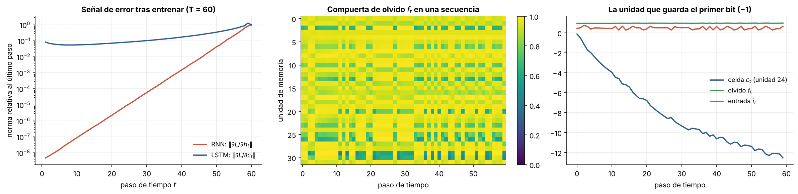
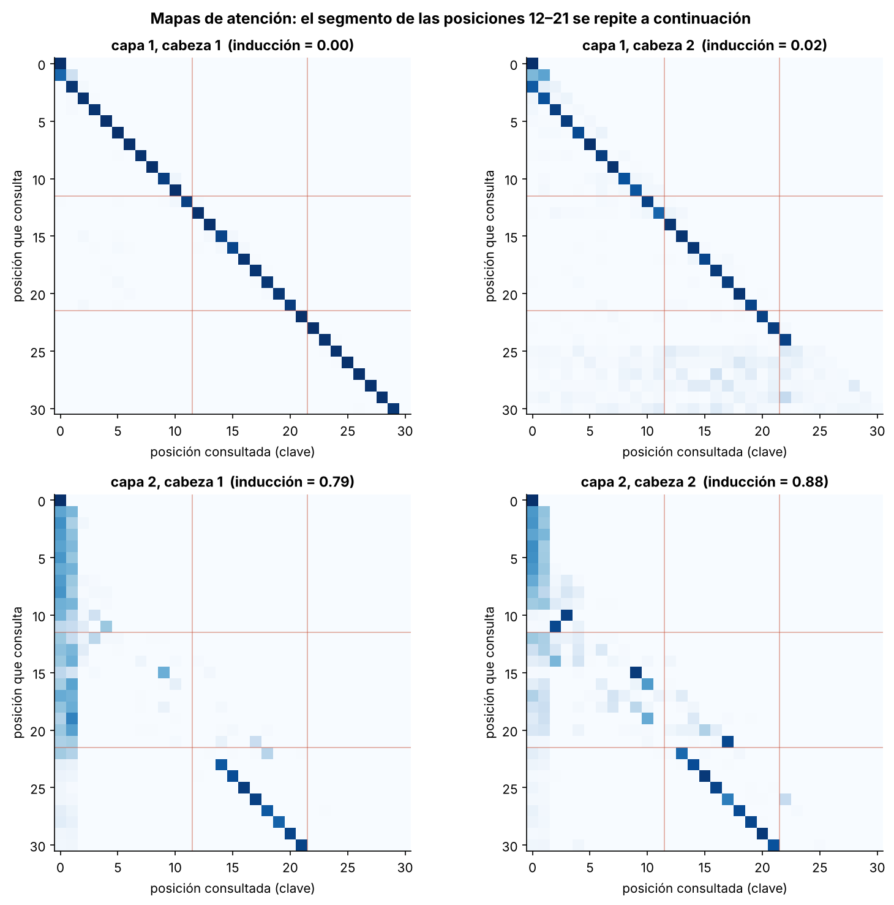
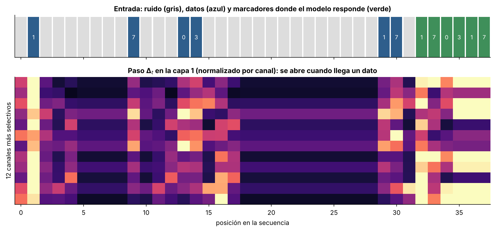
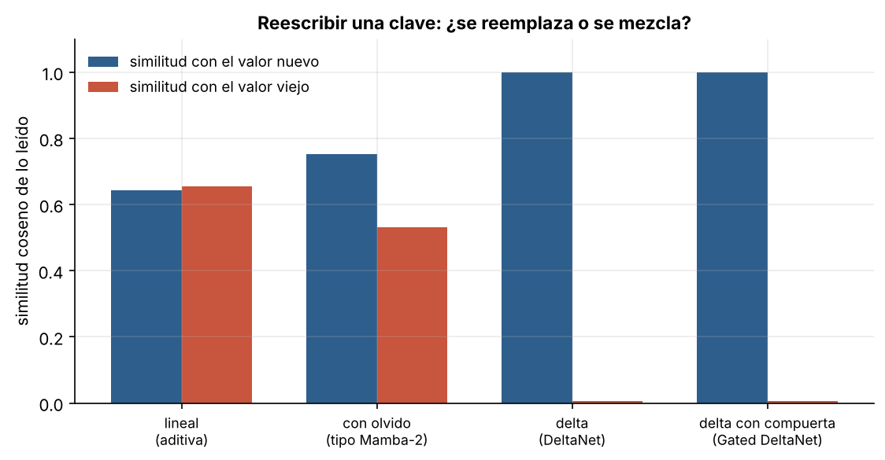

# Notas de curso: arquitecturas de aprendizaje automático

### Del perceptrón a Mamba-3

Estas notas acompañan un curso introductorio sobre el diseño de arquitecturas de redes neuronales. Recorren ochenta años de historia, desde la neurona de McCulloch y Pitts (1943) hasta los modelos híbridos y Mamba-3 (2026), y cuentan cada arquitectura como la respuesta a un problema concreto que la anterior no podía resolver. Se asume que el lector conoce álgebra lineal, cálculo diferencial y probabilidad básica, y que programa con soltura en Python.

Cada sección tiene unas notas (el `README.md` de su carpeta) y un programa con la implementación mínima de la arquitectura: el modelo, su regla de aprendizaje y una ejecución breve que imprime el resultado central de la sección. Las figuras de las notas vienen de experimentos construidos sobre esas implementaciones. Los capítulos 1 y 2 usan solo NumPy, para que cada gradiente esté escrito a mano; a partir del capítulo 3 se usa PyTorch para la diferenciación automática.

* Capítulo 1: Los cimientos
  * 1.1: [La neurona de McCulloch-Pitts](capitulo-1/1.1-mcculloch-pitts/)
  * 1.2: [El perceptrón de Rosenblatt](capitulo-1/1.2-perceptron/)
  * 1.3: [Adaline y la regla delta](capitulo-1/1.3-adaline/)
  * 1.4: [El problema XOR y los límites de una capa](capitulo-1/1.4-xor/)
* Capítulo 2: Profundidad y estructura
  * 2.1: [Perceptrón multicapa y retropropagación](capitulo-2/2.1-perceptron-multicapa/)
  * 2.2: [Redes convolucionales](capitulo-2/2.2-redes-convolucionales/)
  * 2.3: [Redes de Hopfield: memoria asociativa](capitulo-2/2.3-hopfield/)
  * 2.4: [Redes recurrentes de Elman y el gradiente que se desvanece](capitulo-2/2.4-rnn-elman/)
  * 2.5: [LSTM: aprender a recordar](capitulo-2/2.5-lstm/)
* Capítulo 3: La revolución profunda
  * 3.1: [Activaciones e inicialización](capitulo-3/3.1-activaciones-e-inicializacion/)
  * 3.2: [Redes residuales](capitulo-3/3.2-redes-residuales/)
  * 3.3: [Secuencia a secuencia y atención](capitulo-3/3.3-seq2seq-y-atencion/)
* Capítulo 4: El Transformer
  * 4.1: [Autoatención y el Transformer](capitulo-4/4.1-autoatencion-y-transformer/)
  * 4.2: [El costo de la atención y la caché KV](capitulo-4/4.2-costo-y-cache-kv/)
  * 4.3: [Mezcla de expertos](capitulo-4/4.3-mezcla-de-expertos/)
* Capítulo 5: El regreso de la recurrencia
  * 5.1: [Atención lineal: el Transformer era una RNN](capitulo-5/5.1-atencion-lineal/)
  * 5.2: [Modelos de espacio de estados: HiPPO y S4](capitulo-5/5.2-espacios-de-estados-s4/)
  * 5.3: [Mamba: espacios de estados selectivos](capitulo-5/5.3-mamba/)
  * 5.4: [Mamba-2 y la dualidad entre espacios de estados y atención](capitulo-5/5.4-mamba2-dualidad/)
* Capítulo 6: Hoy (2024–2026)
  * 6.1: [La regla delta vuelve: DeltaNet y Gated DeltaNet](capitulo-6/6.1-regla-delta/)
  * 6.2: [Híbridos: cuánta atención hace falta](capitulo-6/6.2-hibridos/)
  * 6.3: [Estados complejos y seguimiento de estado: la idea de Mamba-3](capitulo-6/6.3-estados-complejos/)

## Mapa

Cada flecha lleva el problema que empujó a dar el paso siguiente. Los números son las secciones.



## El hilo conductor

Cada transición se puede leer como un movimiento entre cuatro tensiones:

| Tensión | Pregunta | Ejemplo de fracaso que obligó a cambiar |
|---|---|---|
| Expresividad | ¿Qué funciones puede representar la arquitectura? | El perceptrón no puede con XOR (1.4). |
| Entrenabilidad | ¿Llega la señal de error a todas las capas y a todos los pasos? | Las RNN olvidan porque el gradiente se desvanece (2.4). |
| Eficiencia | ¿Cuánto cuesta en cómputo y memoria, y encaja con el hardware? | La atención cuesta $O(n^2)$ y su caché crece sin límite (4.2). |
| Sesgo inductivo | ¿Cuánto conocimiento del problema se incorpora a la arquitectura? | Las CNN asumen localidad; los Transformers casi nada, y necesitan más datos (2.2, 4.1). |

A partir del capítulo 4 aparece un quinto eje que termina siendo el protagonista: **la memoria**. La atención guarda todo lo que ha visto en una caché que crece; las redes recurrentes lo comprimen en un estado de tamaño fijo. Los capítulos 5 y 6 muestran que la pregunta "¿atención o recurrencia?" se transforma en otra más precisa: qué guardar y con qué regla escribirlo. La respuesta de 2024–2026 reutiliza, casi sin cambios, la regla delta de Widrow y Hoff de 1960 (1.3 y 6.1).

| Año | Sección | Problema que resolvía | Idea clave | Lo que dejó pendiente |
|---|---|---|---|---|
| 1943 | 1.1 | Formalizar el cómputo neuronal | Neurona de umbral = puerta lógica | No aprende |
| 1958–60 | 1.2, 1.3 | Aprender de ejemplos | Corregir los pesos según el error | Solo fronteras lineales |
| 1986 | 2.1 | Funciones no lineales | Capas ocultas y regla de la cadena | Profundidad, estructura, tiempo |
| 1989–98 | 2.2 | Imágenes | Localidad y pesos compartidos | Escala |
| 1982 | 2.3 | Memoria asociativa | Energía con mínimos en los recuerdos | Capacidad limitada |
| 1990 | 2.4 | Secuencias | Estado oculto recurrente | Memoria corta |
| 1997 | 2.5 | Dependencias largas | Celda aditiva y compuertas | Secuencial; estado fijo |
| 2010–15 | 3.1, 3.2 | Redes profundas | ReLU, inicialización, conexiones residuales | El lenguaje seguía en RNN |
| 2014 | 3.3 | Cuello de botella del vector | Atención | Sigue siendo recurrente |
| 2017 | 4.1 | Paralelismo y caminos largos | Autoatención | $O(n^2)$ y caché KV |
| 2017–24 | 4.2, 4.3 | Costo de inferencia | Compartir KV, mezcla de expertos | El costo sigue creciendo con el contexto |
| 2020–22 | 5.1, 5.2 | Costo cuadrático | Recurrencia lineal con estado fijo | No selecciona por contenido |
| 2023–24 | 5.3, 5.4 | Selectividad | Parámetros que dependen de la entrada | Olvida todo por igual |
| 2024–25 | 6.1 | Memoria que no corrige | Regla delta sobre la memoria | Sigue siendo finita |
| 2024–26 | 6.2 | Recall exacto a bajo costo | Pocas capas de atención, muchas lineales | ¿Qué proporción? |
| 2026 | 6.3 | Seguimiento de estado | Transiciones complejas | Abierto |

## Algunos resultados

| | |
|---|---|
|  |  |
| La capa oculta vuelve separable XOR (2.1). | La red de Hopfield moderna recupera letras que la clásica confunde (2.3). |
|  |  |
| La celda de la LSTM conserva el gradiente que la RNN pierde (2.5). | Cabezas de inducción en un Transformer de dos capas (4.1). |
|  |  |
| Mamba abre su paso $\Delta_t$ cuando llega un dato (5.3). | La regla delta reemplaza una asociación; la suma la mezcla (6.1). |

## Cómo ejecutar

```bash
git clone <url-del-repositorio>
cd del-perceptron-a-mamba
python3 -m venv .venv
source .venv/bin/activate
pip install torch --index-url https://download.pytorch.org/whl/cpu
pip install -r requirements.txt
```

En Debian y Ubuntu puede hacer falta `sudo apt install python3-venv`. La primera línea de `pip` instala PyTorch solo para CPU, mucho más liviano que la versión con CUDA.

Cada programa se ejecuta por separado:

```bash
python capitulo-1/1.2-perceptron/perceptron.py
```

Para ejecutarlos todos:

```bash
for programa in capitulo-*/*/*.py; do python "$programa"; done
```

Todo corre en CPU. Los programas de NumPy tardan segundos; los que entrenan modelos recurrentes con un bucle explícito sobre el tiempo (3.3, 5.3 y 6.2) tardan varios minutos. Las semillas están fijas.

## Sitio web

`sitio/construir.py` convierte las notas en un sitio estático: una portada con el índice y el mapa, y una página por sección con las notas, las figuras y el programa completo.

```bash
pip install markdown pygments pymdown-extensions
python sitio/construir.py
python -m http.server -d _sitio 8000
```

En GitHub, el flujo `.github/workflows/pages.yml` lo construye y publica en cada `push` a `main`; basta elegir *GitHub Actions* como fuente en *Settings → Pages*. La línea de autor de la portada se define en `AUTOR` y `ENLACE_AUTOR`, al principio de `sitio/construir.py`.

```
del-perceptron-a-mamba/
├── README.md
├── requirements.txt
├── capitulo-1/
│   ├── 1.1-mcculloch-pitts/
│   │   ├── README.md
│   │   ├── mcculloch_pitts.py
│   │   └── figuras/
│   └── ...
├── capitulo-6/
│   └── ...
├── sitio/
│   ├── construir.py
│   └── estilo.css
└── .github/workflows/pages.yml
```

## Lecturas generales

- Goodfellow, I., Bengio, Y. y Courville, A. (2016). *Deep Learning*. MIT Press. https://www.deeplearningbook.org/
- Prince, S. J. D. (2023). *Understanding Deep Learning*. MIT Press. https://udlbook.github.io/udlbook/
- Nielsen, M. (2015). *Neural Networks and Deep Learning*. http://neuralnetworksanddeeplearning.com/
- Zhang, A., Lipton, Z., Li, M. y Smola, A. *Dive into Deep Learning*. https://d2l.ai/
- *Introduction to Neural Network Models of Cognition*. https://com-cog-book.github.io/com-cog-book/intro
- Bronstein, M., Bruna, J., Cohen, T. y Veličković, P. (2021). Geometric deep learning: grids, groups, graphs, geodesics, and gauges. https://arxiv.org/abs/2104.13478
- Sutton, R. (2019). The bitter lesson. http://www.incompleteideas.net/IncIdeas/BitterLesson.html
- Hooker, S. (2020). The hardware lottery. https://arxiv.org/abs/2009.06489
- Gu, A. (2025). On the tradeoffs of SSMs and transformers. https://goombalab.github.io/blog/2025/tradeoffs/
- Raschka, S. The big LLM architecture comparison. https://magazine.sebastianraschka.com/p/the-big-llm-architecture-comparison
- 3Blue1Brown. Neural networks. https://www.3blue1brown.com/topics/neural-networks
- Karpathy, A. Neural networks: zero to hero. https://karpathy.ai/zero-to-hero.html
- DotCSV (Carlos Santana), divulgación de inteligencia artificial en español. https://www.youtube.com/@DotCSV

El formato de estas notas, un índice por capítulos con una página por sección, sigue el de *Course Notes: Algorithms* de Liang Huang (Oregon State University): https://web.engr.oregonstate.edu/~huanlian/algorithms_course/
