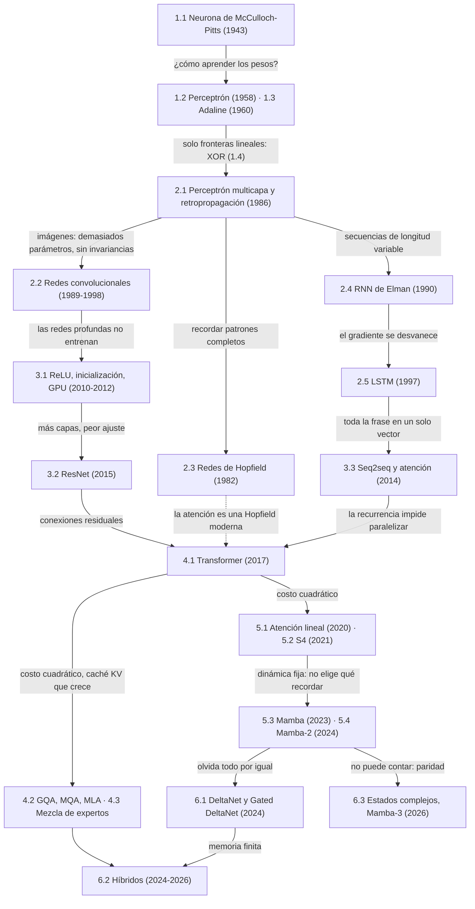

# Notas de curso: arquitecturas de aprendizaje automático

### Del perceptrón a Mamba-3

Implementaciones mínimas de arquitecturas neuronales, de McCulloch-Pitts (1943) a Mamba-3 (2026), cada una como respuesta a la limitación de la anterior. Capítulos 1–2 en NumPy con gradientes a mano; 3–6 en PyTorch.

* Capítulo 1: Los cimientos
  * 1.1: [La neurona de McCulloch-Pitts](capitulo-1/1.1-mcculloch-pitts/)
  * 1.2: [El perceptrón de Rosenblatt](capitulo-1/1.2-perceptron/)
  * 1.3: [Adaline y la regla delta](capitulo-1/1.3-adaline/)
  * 1.4: [El problema XOR y los límites de una capa](capitulo-1/1.4-xor/)
* Capítulo 2: Profundidad y estructura
  * 2.1: [Perceptrón multicapa y retropropagación](capitulo-2/2.1-perceptron-multicapa/)
  * 2.2: [Redes convolucionales](capitulo-2/2.2-redes-convolucionales/)
  * 2.3: [Redes de Hopfield: memoria asociativa](capitulo-2/2.3-hopfield/)
  * 2.4: [Redes recurrentes de Elman y el gradiente que se desvanece](capitulo-2/2.4-rnn-elman/)
  * 2.5: [LSTM: aprender a recordar](capitulo-2/2.5-lstm/)
* Capítulo 3: La revolución profunda
  * 3.1: [Activaciones e inicialización](capitulo-3/3.1-activaciones-e-inicializacion/)
  * 3.2: [Redes residuales](capitulo-3/3.2-redes-residuales/)
  * 3.3: [Secuencia a secuencia y atención](capitulo-3/3.3-seq2seq-y-atencion/)
* Capítulo 4: El Transformer
  * 4.1: [Autoatención y el Transformer](capitulo-4/4.1-autoatencion-y-transformer/)
  * 4.2: [El costo de la atención y la caché KV](capitulo-4/4.2-costo-y-cache-kv/)
  * 4.3: [Mezcla de expertos](capitulo-4/4.3-mezcla-de-expertos/)
* Capítulo 5: El regreso de la recurrencia
  * 5.1: [Atención lineal: el Transformer era una RNN](capitulo-5/5.1-atencion-lineal/)
  * 5.2: [Modelos de espacio de estados: HiPPO y S4](capitulo-5/5.2-espacios-de-estados-s4/)
  * 5.3: [Mamba: espacios de estados selectivos](capitulo-5/5.3-mamba/)
  * 5.4: [Mamba-2 y la dualidad entre espacios de estados y atención](capitulo-5/5.4-mamba2-dualidad/)
* Capítulo 6: Hoy (2024–2026)
  * 6.1: [La regla delta vuelve: DeltaNet y Gated DeltaNet](capitulo-6/6.1-regla-delta/)
  * 6.2: [Híbridos: cuánta atención hace falta](capitulo-6/6.2-hibridos/)
  * 6.3: [Estados complejos y seguimiento de estado: la idea de Mamba-3](capitulo-6/6.3-estados-complejos/)

## Mapa



## Resultados

| | |
|---|---|
|  |  |
| La capa oculta vuelve separable XOR (2.1). | La red de Hopfield moderna recupera letras que la clásica confunde (2.3). |
|  |  |
| La celda de la LSTM conserva el gradiente que la RNN pierde (2.5). | Cabezas de inducción en un Transformer de dos capas (4.1). |
|  |  |
| Mamba abre su paso $\Delta_t$ cuando llega un dato (5.3). | La regla delta reemplaza una asociación; la suma la mezcla (6.1). |

## Uso

```bash
git clone https://github.com/an1nf/nn.git && cd nn
python3 -m venv .venv && source .venv/bin/activate
pip install torch --index-url https://download.pytorch.org/whl/cpu
pip install -r requirements.txt
python capitulo-1/1.2-perceptron/perceptron.py
```

CPU; semillas fijas. 3.3, 5.3 y 6.2 tardan varios minutos.

## Sitio

```bash
pip install markdown pygments pymdown-extensions
python sitio/construir.py && python -m http.server -d _sitio 8000
```

Se publica en GitHub Pages con `.github/workflows/pages.yml` en cada `push` a `main`.

## Referencias

- Goodfellow, Bengio y Courville (2016). *Deep Learning*. https://www.deeplearningbook.org/
- Prince (2023). *Understanding Deep Learning*. https://udlbook.github.io/udlbook/
- Zhang, Lipton, Li y Smola. *Dive into Deep Learning*. https://d2l.ai/
- *Introduction to Neural Network Models of Cognition*. https://com-cog-book.github.io/com-cog-book/intro
- Gu (2025). On the tradeoffs of SSMs and transformers. https://goombalab.github.io/blog/2025/tradeoffs/
