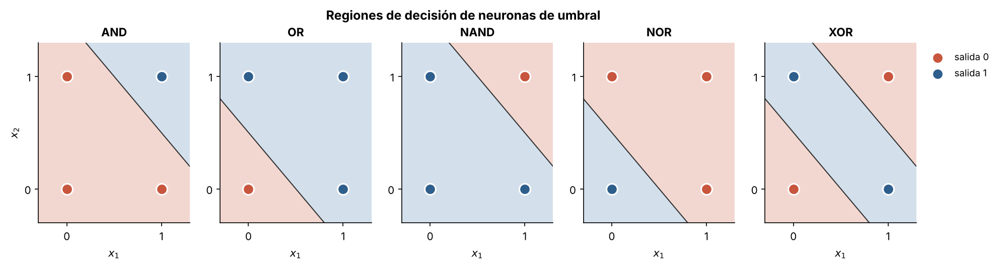
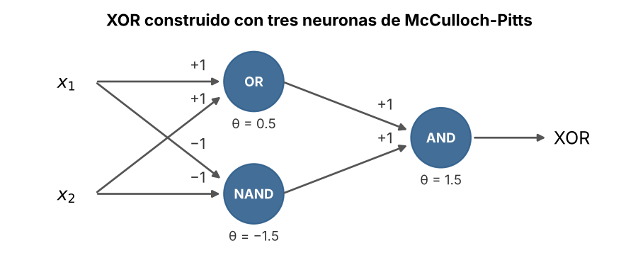

# 1.1 La neurona de McCulloch-Pitts

[Índice](../../README.md) · [Siguiente: 1.2 El perceptrón](../1.2-perceptron/)

## Objetivos

- Entender la neurona de umbral como una función lógica.
- Implementar AND, OR, NAND y NOR con una sola neurona.
- Construir XOR combinando tres neuronas y ver por qué una sola no alcanza.

## Contexto

En 1943, el neurofisiólogo Warren McCulloch y el lógico Walter Pitts publicaron *A logical calculus of the ideas immanent in nervous activity*. Su pregunta era si el sistema nervioso podía describirse con las herramientas de la lógica formal. La respuesta fue un modelo de neurona deliberadamente simple: recibe entradas binarias, las suma con ciertos pesos y "dispara" si la suma alcanza un umbral.

Con esa pieza demostraron que una red de neuronas puede calcular cualquier función lógica. Fue la primera conexión explícita entre neuronas y computación, y una influencia directa en von Neumann al diseñar la arquitectura de los computadores.

Lo que el modelo no tenía era aprendizaje: los pesos y los umbrales se fijan a mano. Seis años después, Donald Hebb propuso en *The Organization of Behavior* una intuición biológica de cómo podrían ajustarse las conexiones (las que se activan juntas se refuerzan), pero faltaba convertirla en un algoritmo.

## Formalización

Una neurona de McCulloch-Pitts con entradas $x_1, \dots, x_n \in \{0, 1\}$, pesos $w_i$ y umbral $\theta$ calcula

$$
y = \begin{cases} 1 & \text{si } \sum_i w_i x_i \ge \theta \\ 0 & \text{en otro caso.} \end{cases}
$$

Con dos entradas, la condición $w_1 x_1 + w_2 x_2 = \theta$ es una **recta** en el plano: la neurona responde 1 de un lado y 0 del otro. Elegir pesos y umbral es elegir dónde poner esa recta. Los valores usados en el código son:

| Puerta | $w_1$ | $w_2$ | $\theta$ |
|---|---|---|---|
| AND | 1 | 1 | 1.5 |
| OR | 1 | 1 | 0.5 |
| NAND | −1 | −1 | −1.5 |
| NOR | −1 | −1 | −0.5 |

Los umbrales están a mitad de camino entre los valores enteros posibles de la suma, de modo que la recta queda lejos de los cuatro puntos.

XOR no admite una recta así (la demostración está en la sección [1.4](../1.4-xor/)), pero sí se puede escribir como composición: $\text{XOR}(x_1, x_2) = \text{AND}\big(\text{OR}(x_1, x_2),\ \text{NAND}(x_1, x_2)\big)$. Son dos capas de neuronas.

## Implementación

[`mcculloch_pitts.py`](mcculloch_pitts.py) define `neurona(x, pesos, umbral)`, la regla de umbral vectorizada; `PUERTAS`, los pesos y umbrales de la tabla anterior; y `xor(x)`, la red de tres neuronas. Al ejecutarlo imprime la tabla de verdad de cada puerta.

```bash
python capitulo-1/1.1-mcculloch-pitts/mcculloch_pitts.py
```

## Resultados

La tabla de verdad de las cinco funciones:

```
x1 x2 |  AND   OR NAND  NOR  XOR
 0  0 |    0    0    1    1    0
 0  1 |    0    1    1    0    1
 1  0 |    0    1    1    0    1
 1  1 |    1    1    0    0    0
```

La figura muestra la región en la que cada neurona responde 1 (azul) cuando las entradas pueden tomar cualquier valor real. Para las cuatro puertas básicas la frontera es una recta. Para XOR, la red de dos capas produce una franja limitada por **dos** rectas, una por cada neurona oculta.



La red que implementa XOR:



## Lo que queda pendiente

1. Los pesos se eligieron a mano. Para cuatro puntos es fácil; para una imagen de miles de píxeles es imposible.
2. Una sola neurona solo traza una recta. XOR necesitó una capa intermedia, y no hay todavía ningún método para encontrar los pesos de esa capa.

El primer problema lo resuelve el perceptrón ([1.2](../1.2-perceptron/)). El segundo tardará más de cuarenta años ([2.1](../../capitulo-2/2.1-perceptron-multicapa/)).

## Referencias

- McCulloch, W. S. y Pitts, W. (1943). A logical calculus of the ideas immanent in nervous activity. *Bulletin of Mathematical Biophysics*, 5, 115–133. https://doi.org/10.1007/BF02478259
- Hebb, D. O. (1949). *The Organization of Behavior*. Wiley.
- *Introduction to Neural Network Models of Cognition*, capítulo «The McCulloch-Pitts Artificial Neuron». https://com-cog-book.github.io/com-cog-book/features/mp-artificial-neuron.html
