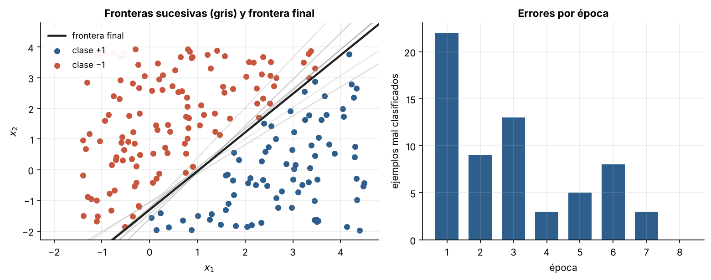
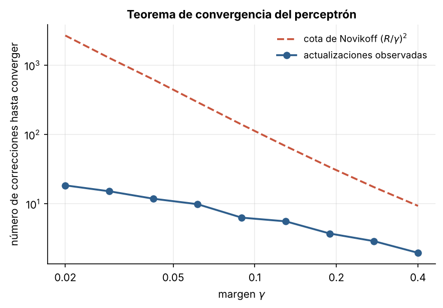

# 1.2 El perceptrón de Rosenblatt

[Índice](../../README.md) · [Anterior: 1.1 McCulloch-Pitts](../1.1-mcculloch-pitts/) · [Siguiente: 1.3 Adaline](../1.3-adaline/)

## Objetivos

- Implementar la regla de aprendizaje del perceptrón.
- Ver cómo se mueve la frontera de decisión durante el entrenamiento.
- Comprobar empíricamente el teorema de convergencia y entender qué garantiza.

## Contexto

Frank Rosenblatt, psicólogo del Cornell Aeronautical Laboratory, presentó el perceptrón en 1958. La pregunta había cambiado respecto a McCulloch y Pitts: ya no era qué puede calcular una red, sino cómo puede **aprender** a partir de ejemplos. Rosenblatt construyó además una máquina física, el Mark I Perceptron, con una retina de 20×20 fotocélulas y pesos guardados en potenciómetros que movían motores eléctricos.

La prensa de la época exageró sus posibilidades hasta el punto de anunciar máquinas que pronto caminarían y hablarían. Es el primer ciclo de expectativas desmedidas de la historia de la inteligencia artificial, y su caída (sección [1.4](../1.4-xor/)) también fue la primera.

## Formalización

Con etiquetas $y \in \{-1, +1\}$, el perceptrón predice

$$
\hat y = \operatorname{sign}(\mathbf w^\top \mathbf x + b).
$$

La regla de aprendizaje es corregir solo cuando hay error, moviendo los pesos en la dirección del ejemplo mal clasificado:

$$
\text{si } y\,(\mathbf w^\top \mathbf x + b) \le 0: \qquad \mathbf w \leftarrow \mathbf w + \eta\, y\, \mathbf x, \qquad b \leftarrow b + \eta\, y.
$$

Después de la corrección, $y\,\mathbf w^\top \mathbf x$ aumenta en $\eta \lVert \mathbf x \rVert^2$: el ejemplo queda "menos mal clasificado".

**Teorema de convergencia (Novikoff, 1962).** Si existe un vector unitario $\mathbf u$ que separa los datos con margen $\gamma$ (es decir, $y_i\, \mathbf u^\top \mathbf x_i \ge \gamma$ para todo $i$) y todos los puntos cumplen $\lVert \mathbf x_i \rVert \le R$, entonces el perceptrón comete como máximo

$$
\left(\frac{R}{\gamma}\right)^2
$$

errores antes de encontrar una frontera que separa todo. La cota no depende del número de ejemplos ni de la dimensión. La demostración cabe en media página: cada corrección aumenta $\mathbf w^\top \mathbf u$ en al menos $\gamma$ y aumenta $\lVert \mathbf w \rVert^2$ en a lo sumo $R^2$; como $\mathbf w^\top \mathbf u \le \lVert \mathbf w \rVert$, tras $k$ correcciones $k\gamma \le \sqrt{k} R$.

## Implementación

[`perceptron.py`](perceptron.py) contiene la clase `Perceptron`, con `predecir` y `entrenar`; este último corrige solo los ejemplos mal clasificados y devuelve la época en que deja de haber errores. Al ejecutarlo entrena sobre 200 puntos separables.

```bash
python capitulo-1/1.2-perceptron/perceptron.py
```

## Resultados

El perceptrón converge en 8 épocas. Los errores por época no bajan de forma monótona (22, 9, 13, 3, 5, 8, 3, 0): cada corrección arregla un punto y puede estropear otros. Las fronteras intermedias, en gris, oscilan alrededor de la solución.



La comparación con la cota de Novikoff muestra que el número de correcciones crece cuando el margen se achica, como predice el teorema, pero queda uno o dos órdenes de magnitud por debajo. La cota describe el peor caso posible, no el típico.



## Lo que queda pendiente

- El teorema solo vale si los datos son **linealmente separables**. Si no lo son, el perceptrón nunca se estabiliza (se ve en [1.3](../1.3-adaline/)).
- La regla corrige con un salto de tamaño fijo y no tiene en cuenta *cuánto* se equivocó. Adaline cambiará eso.
- Una sola neurona sigue trazando una sola recta. Lo que eso implica se estudia en [1.4](../1.4-xor/).

## Referencias

- Rosenblatt, F. (1958). The perceptron: A probabilistic model for information storage and organization in the brain. *Psychological Review*, 65(6), 386–408. https://doi.org/10.1037/h0042519
- Novikoff, A. B. J. (1962). On convergence proofs on perceptrons. *Symposium on the Mathematical Theory of Automata*, 12, 615–622.
- *Introduction to Neural Network Models of Cognition*, capítulo «The Perceptron». https://com-cog-book.github.io/com-cog-book/features/perceptron.html
