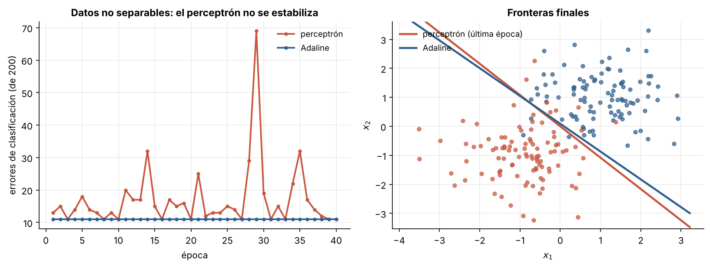
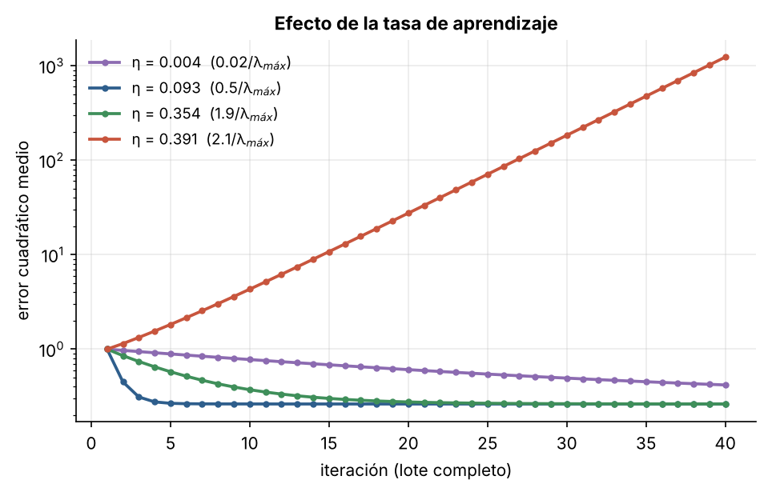
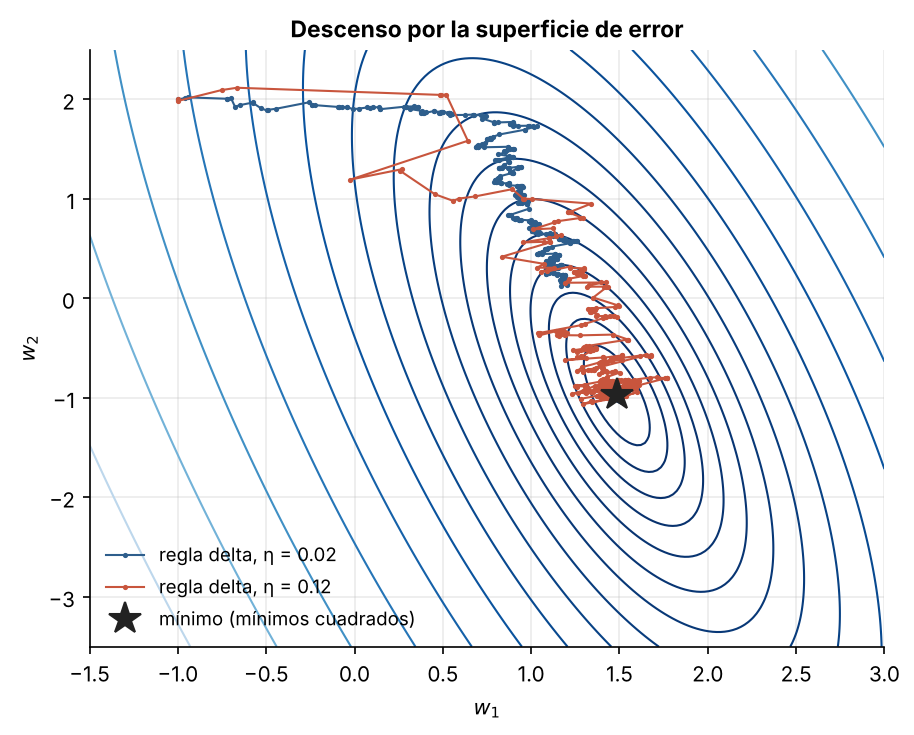

# 1.3 Adaline y la regla delta

[Índice](../../README.md) · [Anterior: 1.2 El perceptrón](../1.2-perceptron/) · [Siguiente: 1.4 XOR](../1.4-xor/)

## Objetivos

- Formular el aprendizaje como minimización de una función de pérdida.
- Implementar la regla delta (LMS) y compararla con el perceptrón en datos que no son separables.
- Entender el papel de la tasa de aprendizaje y cuándo el descenso de gradiente diverge.

## Contexto

En 1960, Bernard Widrow y su estudiante Ted Hoff, en Stanford, presentaron Adaline (*ADAptive LINear Element*). La diferencia con el perceptrón parece pequeña: Adaline corrige los pesos según el error de su **salida lineal**, antes del umbral, y no según el error de la salida binaria. Pero ese cambio convierte el aprendizaje en un problema de optimización: hay una función de error diferenciable y los pesos bajan por su gradiente.

La misma regla, con el nombre de *least mean squares*, se volvió una herramienta estándar del procesamiento de señales (filtros adaptativos, cancelación de eco). Y, como se verá en el capítulo 6, reaparece casi sin cambios en los modelos de lenguaje de 2025 y 2026.

## Formalización

Adaline minimiza el error cuadrático de su salida lineal $z = \mathbf w^\top \mathbf x + b$:

$$
E(\mathbf w, b) = \frac{1}{2} \sum_i \left(y_i - \mathbf w^\top \mathbf x_i - b\right)^2.
$$

El gradiente respecto a $\mathbf w$ para un solo ejemplo es $-(y - \mathbf w^\top \mathbf x - b)\,\mathbf x$, así que un paso de descenso de gradiente estocástico da la **regla delta**:

$$
\boxed{\ \mathbf w \leftarrow \mathbf w + \eta\,\big(y - \mathbf w^\top \mathbf x - b\big)\,\mathbf x\ }
$$

A diferencia del perceptrón, la corrección es proporcional al tamaño del error y se aplica siempre, no solo cuando la clasificación falla. Para clasificar se usa $\operatorname{sign}(z)$.

**Estabilidad.** Con descenso por lotes, el error es una función cuadrática con matriz hessiana $H = \frac{2}{n} X^\top X$. El método converge si $\eta < 2/\lambda_{\max}(H)$ y diverge si se supera ese valor, porque en la dirección del autovector principal cada paso multiplica el error por $|1 - \eta \lambda_{\max}|$.

## Implementación

[`adaline.py`](adaline.py) contiene la clase `Adaline`. `entrenar` aplica la regla delta ejemplo a ejemplo y devuelve el error cuadrático medio final. Al ejecutarlo entrena sobre dos nubes gaussianas que se solapan.

```bash
python capitulo-1/1.3-adaline/adaline.py
```

## Resultados

Con datos solapados, el perceptrón nunca deja de corregir: cada época cambia la frontera y el número de errores salta entre 11 y casi 70. Adaline se estabiliza en una frontera fija con 11 errores, que es esencialmente lo mejor que puede hacer una recta con estos datos.



La curvatura máxima del problema es $\lambda_{\max} \approx 5.37$, así que el descenso por lotes diverge para $\eta > 0.372$. Una tasa diminuta converge muy despacio; una de $0.5/\lambda_{\max}$ converge en pocas iteraciones; una de $1.9/\lambda_{\max}$ todavía converge, oscilando; y $2.1/\lambda_{\max}$ diverge exponencialmente.



Sobre la superficie de error, la regla delta avanza hacia el mínimo de mínimos cuadrados (la estrella). Con una tasa mayor llega antes pero zigzaguea más, porque cada paso usa un solo ejemplo.



## Lo que queda pendiente

Adaline aprende mejor que el perceptrón, pero sigue siendo **lineal**: su frontera es una recta. Si el problema exige una frontera curva, ninguna regla de aprendizaje lo arregla. Ese es el tema de [1.4](../1.4-xor/).

Conviene recordar la ecuación recuadrada. En la sección [6.1](../../capitulo-6/6.1-regla-delta/) aparece otra vez, ahora como la forma en que una red recurrente moderna escribe en su memoria.

## Referencias

- Widrow, B. y Hoff, M. E. (1960). Adaptive switching circuits. *IRE WESCON Convention Record*, 4, 96–104.
- Widrow, B. y Lehr, M. A. (1990). 30 years of adaptive neural networks: perceptron, madaline, and backpropagation. *Proceedings of the IEEE*, 78(9), 1415–1442. https://doi.org/10.1109/5.58323
- *Introduction to Neural Network Models of Cognition*, capítulo «The ADALINE». https://com-cog-book.github.io/com-cog-book/features/adaline.html
