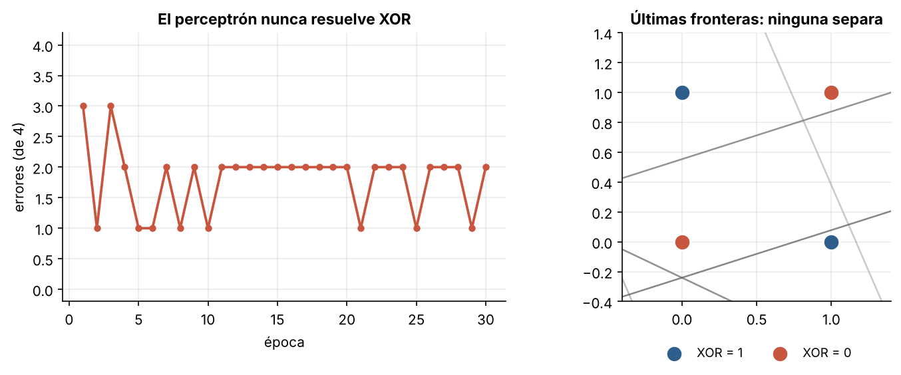
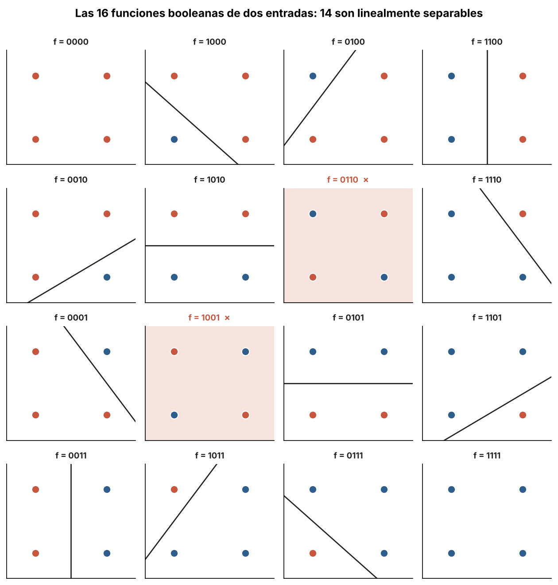
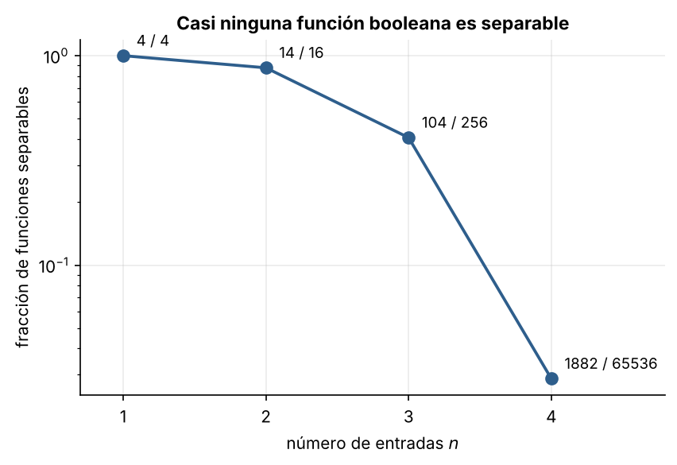
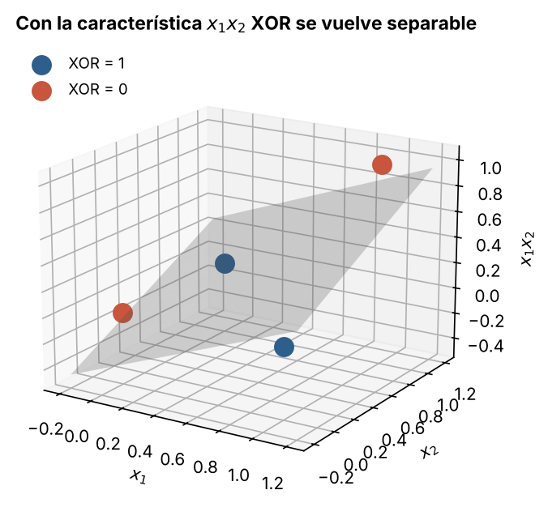

# 1.4 El problema XOR y los límites de una capa

[Índice](../../README.md) · [Anterior: 1.3 Adaline](../1.3-adaline/) · [Siguiente: 2.1 Perceptrón multicapa](../../capitulo-2/2.1-perceptron-multicapa/)

## Objetivos

- Demostrar que ninguna recta separa XOR y verlo en un entrenamiento real.
- Contar cuántas funciones booleanas puede representar una sola neurona de umbral.
- Ver que una transformación no lineal de la entrada vuelve separable el problema.

## Contexto

En 1969, Marvin Minsky y Seymour Papert publicaron *Perceptrons*, un análisis matemático riguroso de lo que un perceptrón de una capa puede y no puede calcular. Mostraron, entre otras cosas, que no puede decidir la paridad de sus entradas (XOR es la paridad de dos bits) ni si una figura es conexa, salvo con recursos que crecen de forma prohibitiva.

Sabían que una red con capas intermedias sí podía representar esas funciones. El problema era que no había un método práctico para entrenar esas capas: si la red se equivoca, ¿cuánta culpa tiene cada neurona oculta, cuya salida correcta nadie conoce? Es el **problema de la asignación de crédito**.

El libro contribuyó, junto con promesas incumplidas y recortes de financiación, al primer "invierno" de la investigación en redes neuronales. Hoy se discute cuánto peso tuvo el libro en sí, pero el diagnóstico técnico era correcto.

## Formalización

Supongamos que existen $w_1, w_2, b$ tales que $w_1 x_1 + w_2 x_2 + b > 0$ exactamente cuando $\text{XOR}(x_1, x_2) = 1$.

1. $(0,0) \mapsto 0$ exige $b < 0$.
2. $(0,1) \mapsto 1$ y $(1,0) \mapsto 1$ exigen $w_2 + b > 0$ y $w_1 + b > 0$. Sumando: $w_1 + w_2 + 2b > 0$, es decir, $w_1 + w_2 + b > -b > 0$.
3. Pero $(1,1) \mapsto 0$ exige $w_1 + w_2 + b < 0$. Contradicción.

Más en general, una función booleana de $n$ entradas es **linealmente separable** si un hiperplano separa los vértices del hipercubo $\{0,1\}^n$ donde vale 1 de aquellos donde vale 0. Por el teorema de convergencia de [1.2](../1.2-perceptron/), el perceptrón encuentra ese hiperplano siempre que exista. Basta con entrenarlo sobre cada una de las $2^{2^n}$ funciones y contar en cuántas converge.

## Implementación

[`xor.py`](xor.py) contiene `separables(n)`, que entrena **en paralelo** un perceptrón por cada función booleana de $n$ entradas (65 536 funciones para $n = 4$) con operaciones vectorizadas de NumPy y devuelve cuáles convergen. Al ejecutarlo imprime el conteo para $n = 1, \dots, 4$.

```bash
python capitulo-1/1.4-xor/xor.py
```

## Resultados

El perceptrón nunca baja de un error sobre XOR: en cada época corrige un punto y estropea otro.



De las 16 funciones de dos entradas, 14 son separables. Las dos que no lo son (marcadas en rojo) son XOR y su negación.



El conteo para más entradas coincide con los valores conocidos en la literatura (secuencia A000609 de la OEIS):

| $n$ | funciones | separables | fracción |
|---|---|---|---|
| 1 | 4 | 4 | 100 % |
| 2 | 16 | 14 | 87.5 % |
| 3 | 256 | 104 | 40.6 % |
| 4 | 65 536 | 1 882 | 2.9 % |

La fracción cae en picada: con muchas entradas, casi ninguna función es representable por una sola neurona.



La salida, sin embargo, no está lejos. Si se añade a mano la característica $x_1 x_2$, los cuatro puntos viven en tres dimensiones y el plano $x_1 + x_2 - 2x_1x_2 = 0.5$ los separa. El problema no es la regla de aprendizaje, es la **representación**.



## Lo que queda pendiente

Inventar la característica correcta a mano no escala. Lo que se necesita es una red que **aprenda** sus propias características en una capa intermedia, y un algoritmo que reparta la culpa del error entre esas neuronas ocultas. Eso es la retropropagación ([2.1](../../capitulo-2/2.1-perceptron-multicapa/)).

## Referencias

- Minsky, M. y Papert, S. (1969). *Perceptrons: An Introduction to Computational Geometry*. MIT Press.
- Olazaran, M. (1996). A sociological study of the official history of the perceptrons controversy. *Social Studies of Science*, 26(3), 611–659. https://doi.org/10.1177/030631296026003005
- OEIS A000609: número de funciones de umbral de $n$ variables. https://oeis.org/A000609
