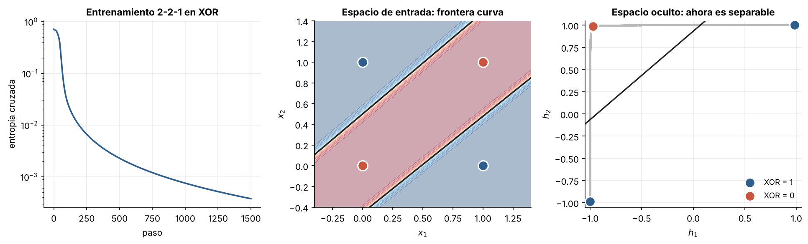
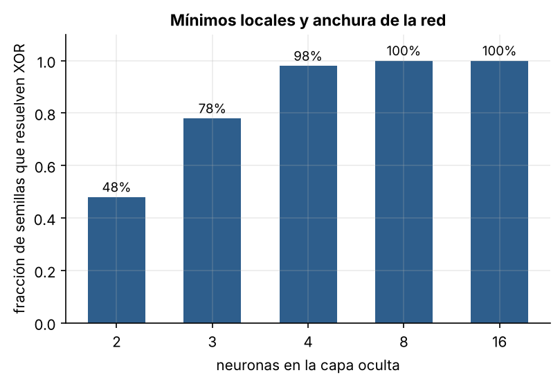
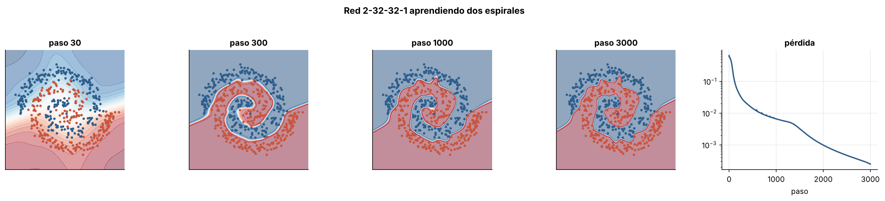

# 2.1 Perceptrón multicapa y retropropagación

[Índice](../../README.md) · [Anterior: 1.4 XOR](../../capitulo-1/1.4-xor/) · [Siguiente: 2.2 Redes convolucionales](../2.2-redes-convolucionales/)

## Objetivos

- Implementar la retropropagación desde cero y verificarla contra derivadas numéricas.
- Resolver XOR con una capa oculta y ver qué representación aprende esa capa.
- Observar el efecto de la inicialización y de la anchura en la presencia de mínimos locales.
- Ajustar una frontera muy no lineal (dos espirales).

## Contexto

La solución al problema de la asignación de crédito tiene dos ingredientes. El primero es reemplazar el escalón del perceptrón por una función suave (sigmoide o tangente hiperbólica), para que la salida sea diferenciable respecto a cada peso. El segundo es aplicar la regla de la cadena de atrás hacia adelante, reutilizando cálculos, para obtener todas las derivadas con un costo similar al de una pasada hacia adelante.

La idea matemática, la diferenciación automática en modo inverso, aparece en la tesis de maestría de Seppo Linnainmaa (1970). Paul Werbos propuso usarla para entrenar redes neuronales en 1974. El artículo de Rumelhart, Hinton y Williams en *Nature* (1986) la popularizó y mostró algo decisivo: las capas ocultas aprenden por sí solas representaciones internas útiles.

Poco después, Cybenko (1989) y Hornik, Stinchcombe y White (1989) demostraron el **teorema de aproximación universal**: una red con una sola capa oculta suficientemente ancha puede aproximar cualquier función continua en un dominio acotado. El teorema no dice cuántas neuronas hacen falta ni si el descenso de gradiente las encontrará.

## Formalización

Para una red con una capa oculta,

$$
\mathbf h = \tanh(W_1 \mathbf x + \mathbf b_1), \qquad z = W_2 \mathbf h + b_2, \qquad L = \text{entropía cruzada}(\sigma(z), y).
$$

Hacia atrás, el error se propaga capa por capa:

$$
\delta_2 = \sigma(z) - y, \qquad \boldsymbol\delta_1 = (W_2^\top \delta_2) \odot (1 - \mathbf h^2),
$$

$$
\frac{\partial L}{\partial W_2} = \delta_2\, \mathbf h^\top, \qquad \frac{\partial L}{\partial W_1} = \boldsymbol\delta_1\, \mathbf x^\top.
$$

Cada gradiente tiene la forma "error que llega a la capa × entrada de la capa", la misma estructura que la regla delta de Adaline. La retropropagación es la regla delta aplicada capa por capa, con el error de las capas ocultas calculado a partir del error de la siguiente.

## Implementación

[`perceptron_multicapa.py`](perceptron_multicapa.py) define `Densa` y `Tanh`, cada una con `adelante` y `atras`; `Red`, que encadena capas y calcula la pérdida y todos los gradientes; y `Adam`, escrito a mano. Al ejecutarlo entrena una red 2-2-1 sobre XOR.

```bash
python capitulo-2/2.1-perceptron-multicapa/perceptron_multicapa.py
```

## Resultados

La verificación de gradientes da un error relativo máximo de $3.6 \times 10^{-7}$: la retropropagación está bien implementada.

Una red 2-2-1 resuelve XOR. El panel derecho muestra lo importante: la capa oculta transforma los cuatro puntos de modo que en el espacio $(h_1, h_2)$ **sí** son separables por una recta. La red aprendió la característica que en [1.4](../../capitulo-1/1.4-xor/) tuvimos que inventar a mano.



Pero la red de dos neuronas ocultas solo encuentra la solución en 24 de 50 inicializaciones; en el resto se queda en un mínimo local que acierta tres de los cuatro puntos. Con más neuronas ocultas el problema desaparece: 49 de 50 con cuatro neuronas y 50 de 50 con ocho o más. Las redes sobredimensionadas son más fáciles de optimizar, una observación que se volverá central con las redes profundas.



Con dos capas ocultas de 32 neuronas, la red separa dos espirales entrelazadas. A los 30 pasos la frontera es casi recta; a los 300 ya sigue la forma de los brazos; a los 3000 clasifica todos los puntos de entrenamiento.



## Lo que queda pendiente

- **Profundidad.** La derivada de la tangente hiperbólica es menor que 1 casi en todas partes. Al multiplicar muchas de ellas, el gradiente se encoge exponencialmente con el número de capas. Durante veinte años las redes útiles tuvieron pocas capas ([3.1](../../capitulo-3/3.1-activaciones-e-inicializacion/)).
- **Estructura.** Un perceptrón multicapa trata una imagen como una lista de números sin orden y no sabe que un dígito desplazado un píxel sigue siendo el mismo dígito ([2.2](../2.2-redes-convolucionales/)).
- **Tiempo.** No sabe qué hacer con secuencias de longitud variable ([2.4](../2.4-rnn-elman/)).

## Referencias

- Rumelhart, D. E., Hinton, G. E. y Williams, R. J. (1986). Learning representations by back-propagating errors. *Nature*, 323, 533–536. https://doi.org/10.1038/323533a0
- Linnainmaa, S. (1970). *The representation of the cumulative rounding error of an algorithm as a Taylor expansion of the local rounding errors*. Tesis de maestría, Universidad de Helsinki.
- Werbos, P. (1974). *Beyond Regression: New Tools for Prediction and Analysis in the Behavioral Sciences*. Tesis doctoral, Harvard.
- Cybenko, G. (1989). Approximation by superpositions of a sigmoidal function. *Mathematics of Control, Signals and Systems*, 2, 303–314. https://doi.org/10.1007/BF02551274
- Hornik, K., Stinchcombe, M. y White, H. (1989). Multilayer feedforward networks are universal approximators. *Neural Networks*, 2(5), 359–366. https://doi.org/10.1016/0893-6080(89)90020-8
- Kingma, D. P. y Ba, J. (2014). Adam: A method for stochastic optimization. https://arxiv.org/abs/1412.6980
- *Introduction to Neural Network Models of Cognition*, capítulo «The Multilayer Perceptron». https://com-cog-book.github.io/com-cog-book/features/multilayer-perceptron.html
