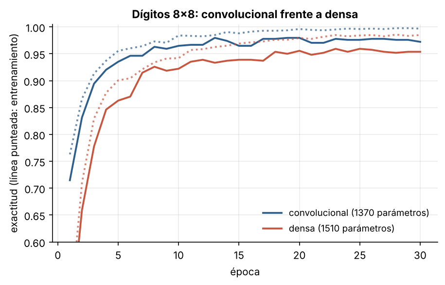
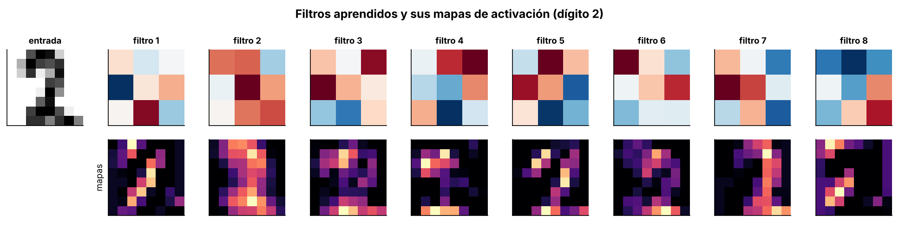
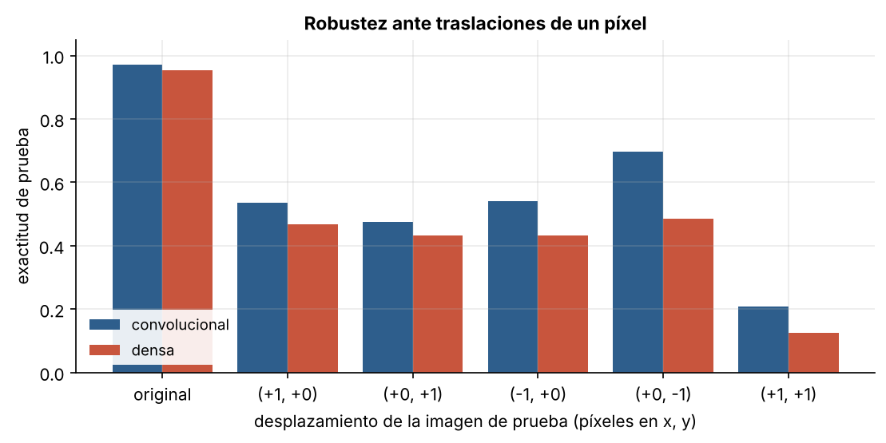

# 2.2 Redes convolucionales

[Índice](../../README.md) · [Anterior: 2.1 Perceptrón multicapa](../2.1-perceptron-multicapa/) · [Siguiente: 2.3 Redes de Hopfield](../2.3-hopfield/)

## Objetivos

- Implementar una capa convolucional con su retropropagación usando solo NumPy.
- Comparar una red convolucional con una densa del mismo tamaño sobre imágenes de dígitos.
- Verificar la equivarianza a traslaciones y medir hasta dónde llega en la práctica.

## Contexto

En 1959 y 1962, David Hubel y Torsten Wiesel registraron neuronas de la corteza visual del gato y encontraron que muchas responden a bordes con una orientación concreta dentro de una zona pequeña del campo visual, mientras que otras, más "complejas", toleran que el estímulo se desplace. Recibieron el Nobel de Medicina en 1981.

Kunihiko Fukushima tradujo esa jerarquía en el **Neocognitrón** (1980), todavía sin retropropagación. Yann LeCun y sus colaboradores en Bell Labs la combinaron con descenso de gradiente (1989) y llegaron a LeNet-5 (1998), que se usó comercialmente para leer códigos postales y cheques.

La idea de fondo es el **sesgo inductivo**: incorporar en la arquitectura lo que sabemos del problema. En una imagen, lo que importa suele ser local y puede aparecer en cualquier posición. Una capa convolucional asume exactamente eso.

## Formalización

Una convolución (en rigor, una correlación cruzada) con un filtro $\mathbf k$ de $3 \times 3$:

$$
(\mathbf x * \mathbf k)[i,j] = \sum_{m=0}^{2}\sum_{n=0}^{2} \mathbf x[i+m-1,\ j+n-1]\ \mathbf k[m,n].
$$

Tres propiedades:

1. **Conectividad local.** Cada salida depende de una ventana de $3 \times 3$ píxeles.
2. **Pesos compartidos.** El mismo filtro se aplica en todas las posiciones. Una capa con 8 filtros de $3 \times 3$ tiene 80 parámetros, sin importar el tamaño de la imagen.
3. **Equivarianza a traslaciones.** Si $T$ desplaza la imagen, $\operatorname{conv}(T\mathbf x) = T\operatorname{conv}(\mathbf x)$ (salvo en los bordes).

La implementación usa el truco *im2col*: extraer todas las ventanas en una matriz y convertir la convolución en un producto de matrices. Hacia atrás, el gradiente respecto a los pesos es otro producto de matrices y el gradiente respecto a la entrada se acumula ventana por ventana.

## Implementación

[`red_convolucional.py`](red_convolucional.py) define `Convolucion` (con im2col), `ReLU`, `MaxPool`, `Aplanar`, `Densa`, `Secuencial` y `Adam`, todos con la pasada hacia atrás escrita a mano. Al ejecutarlo entrena la red convolucional (conv 3×3 con 8 filtros → ReLU → max-pool 2×2 → densa 128→10) sobre los dígitos de 8×8 de scikit-learn.

```bash
python capitulo-2/2.2-redes-convolucionales/red_convolucional.py
```

## Resultados

El gradiente de la convolución coincide con el numérico (error relativo máximo $1.9 \times 10^{-8}$) y la equivarianza se cumple exactamente en el interior de la imagen.

Con menos parámetros, la red convolucional aprende más rápido y llega a 97.2 % de exactitud en prueba, frente a 95.4 % de la densa.



Los filtros aprendidos son detectores de bordes y esquinas en distintas orientaciones. Cada mapa de activación muestra dónde aparece ese patrón en el dígito.



La prueba de robustez es más matizada de lo que suele contarse. Al desplazar las imágenes de prueba un píxel, **ambas** redes pierden mucha exactitud, aunque la convolucional cae menos en todos los casos (por ejemplo, 54 % frente a 47 % con un desplazamiento horizontal). La convolución es equivariante, pero la capa densa final no lo es: aprendió en qué posición del mapa esperar cada rasgo. En imágenes de 8×8, un píxel es el 12 % del ancho. Para obtener invariancia real hace falta agregación global (*pooling* sobre toda la imagen) o entrenar con datos desplazados.



## Lo que queda pendiente

Las redes convolucionales funcionaban en 1998, pero se quedaron en tareas acotadas. Faltaban conjuntos de datos grandes, cómputo para redes profundas y técnicas que permitieran entrenar muchas capas. Todo eso llegó junto en 2012 ([3.1](../../capitulo-3/3.1-activaciones-e-inicializacion/)).

## Referencias

- Hubel, D. H. y Wiesel, T. N. (1962). Receptive fields, binocular interaction and functional architecture in the cat's visual cortex. *The Journal of Physiology*, 160(1), 106–154. https://doi.org/10.1113/jphysiol.1962.sp006837
- Fukushima, K. (1980). Neocognitron. *Biological Cybernetics*, 36, 193–202. https://doi.org/10.1007/BF00344251
- LeCun, Y. et al. (1989). Backpropagation applied to handwritten zip code recognition. *Neural Computation*, 1(4), 541–551. https://doi.org/10.1162/neco.1989.1.4.541
- LeCun, Y., Bottou, L., Bengio, Y. y Haffner, P. (1998). Gradient-based learning applied to document recognition. *Proceedings of the IEEE*, 86(11), 2278–2324. https://doi.org/10.1109/5.726791
- Bronstein, M., Bruna, J., Cohen, T. y Veličković, P. (2021). Geometric deep learning: grids, groups, graphs, geodesics, and gauges. https://arxiv.org/abs/2104.13478
- *Introduction to Neural Network Models of Cognition*, capítulo «The Convolutional Neural Network». https://com-cog-book.github.io/com-cog-book/features/cov-net.html
