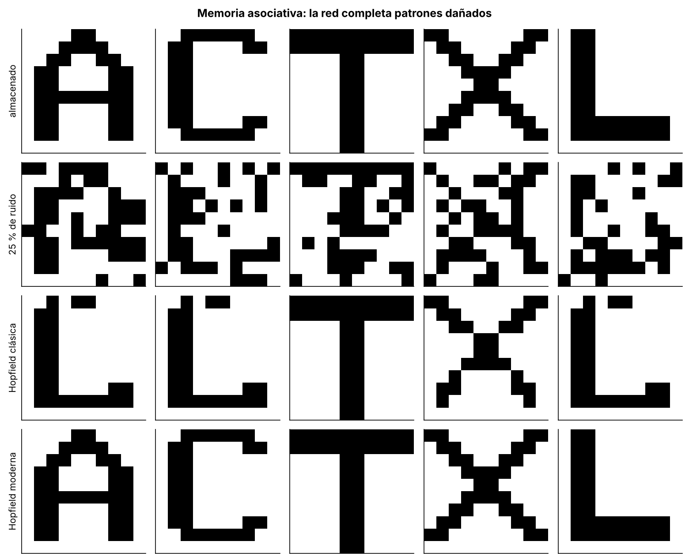
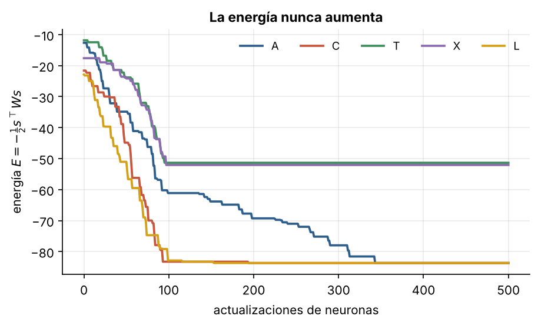
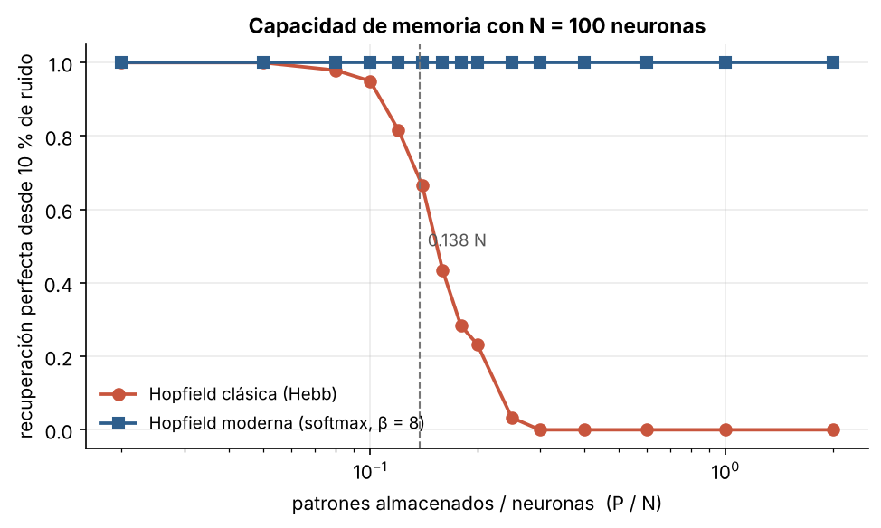

# 2.3 Redes de Hopfield: memoria asociativa

[Índice](../../README.md) · [Anterior: 2.2 Redes convolucionales](../2.2-redes-convolucionales/) · [Siguiente: 2.4 RNN de Elman](../2.4-rnn-elman/)

## Objetivos

- Almacenar patrones con la regla de Hebb y recuperarlos a partir de versiones dañadas.
- Ver la función de energía que garantiza que la dinámica se detiene.
- Medir la capacidad de la red clásica y compararla con la red de Hopfield moderna, cuya regla de actualización es la atención de los Transformers.

## Contexto

En 1982, el físico John Hopfield propuso una red recurrente que funciona como **memoria direccionable por contenido**: en lugar de buscar un recuerdo por su dirección, se le entrega un fragmento o una versión ruidosa y la red completa el resto. La idea venía de la física de materiales magnéticos desordenados (vidrios de espín): los patrones almacenados son mínimos de una energía y la dinámica de la red siempre desciende hacia uno de ellos.

El trabajo devolvió el interés de los físicos por las redes neuronales en pleno invierno de la disciplina. En 2024, Hopfield y Geoffrey Hinton recibieron el Premio Nobel de Física por estos fundamentos.

Cuatro décadas después, Ramsauer y colaboradores (2020) mostraron que una versión moderna de la red, con estados continuos y una energía exponencial, tiene una regla de actualización idéntica a la atención softmax. Esta sección es el primer contacto con la idea que domina la segunda mitad del curso: **una capa de una red puede verse como una memoria asociativa**.

## Formalización

**Red clásica.** Estados $s_i \in \{-1, +1\}$, $N$ neuronas, $P$ patrones $\boldsymbol\xi^\mu$. Pesos con la regla de Hebb:

$$
W = \frac{1}{N} \sum_{\mu=1}^{P} \boldsymbol\xi^\mu (\boldsymbol\xi^\mu)^\top, \qquad W_{ii} = 0.
$$

Actualización asíncrona (una neurona a la vez): $s_i \leftarrow \operatorname{sign}\big(\sum_j W_{ij} s_j\big)$. La energía

$$
E(\mathbf s) = -\tfrac{1}{2}\, \mathbf s^\top W \mathbf s
$$

nunca aumenta con una actualización, así que la dinámica termina en un mínimo local. Si los patrones son aleatorios, la recuperación funciona hasta unos $P \approx 0.138\,N$ patrones (Amit, Gutfreund y Sompolinsky, 1985); más allá, la interferencia entre recuerdos crea mínimos espurios.

**Red moderna.** Con la matriz de patrones $X$ (una fila por patrón, normalizada) y un estado $\boldsymbol\xi$, un paso de actualización es

$$
\boldsymbol\xi^{\text{nuevo}} = X^\top \operatorname{softmax}\!\left(\beta\, X \boldsymbol\xi\right).
$$

Es exactamente la atención: la consulta es $\boldsymbol\xi$ y las claves y los valores son los patrones almacenados. Su capacidad crece exponencialmente con $N$.

## Implementación

[`hopfield.py`](hopfield.py) define la clase `Hopfield` (pesos de Hebb, energía y recuerdo asíncrono) y `recuperacion_moderna`, un paso de la red moderna con softmax. Al ejecutarlo guarda diez patrones aleatorios de 100 neuronas y recupera uno con un 10 % de ruido.

```bash
python capitulo-2/2.3-hopfield/hopfield.py
```

## Resultados

Las letras no son patrones aleatorios: comparten trazos (la A, la C y la L tienen la misma barra izquierda). En la red clásica esa correlación genera interferencia: la T y la X se recuperan casi perfectamente, pero la A y la C caen en un estado espurio que se parece a la L. La red moderna recupera las cinco letras sin errores.



La energía desciende en cada actualización hasta estabilizarse. La A y la C terminan en el mismo mínimo que la L.



Con patrones aleatorios, la red clásica recupera el 95 % de los patrones con $P = 0.10\,N$, el 67 % con $P = 0.14\,N$ y ninguno a partir de $P = 0.3\,N$, en línea con el límite teórico de $0.138\,N$. La red moderna recupera todos los patrones incluso con el doble de patrones que neuronas.



## Lo que queda pendiente

La red de Hopfield es recurrente, pero no procesa secuencias: converge a un punto fijo. Para leer una frase o una señal hace falta una red cuyo estado evolucione con una entrada que cambia en el tiempo ([2.4](../2.4-rnn-elman/)).

La memoria moderna, por su parte, guarda **todos** los patrones de forma explícita. Esa es la virtud y el costo de la atención, y la tensión entre guardarlo todo y comprimir organiza los capítulos 4, 5 y 6.

## Referencias

- Hopfield, J. J. (1982). Neural networks and physical systems with emergent collective computational abilities. *PNAS*, 79(8), 2554–2558. https://doi.org/10.1073/pnas.79.8.2554
- Amit, D. J., Gutfreund, H. y Sompolinsky, H. (1985). Storing infinite numbers of patterns in a spin-glass model of neural networks. *Physical Review Letters*, 55(14), 1530–1533. https://doi.org/10.1103/PhysRevLett.55.1530
- Ramsauer, H. et al. (2020). Hopfield networks is all you need. https://arxiv.org/abs/2008.02217
- Premio Nobel de Física 2024. https://www.nobelprize.org/prizes/physics/2024/summary/
