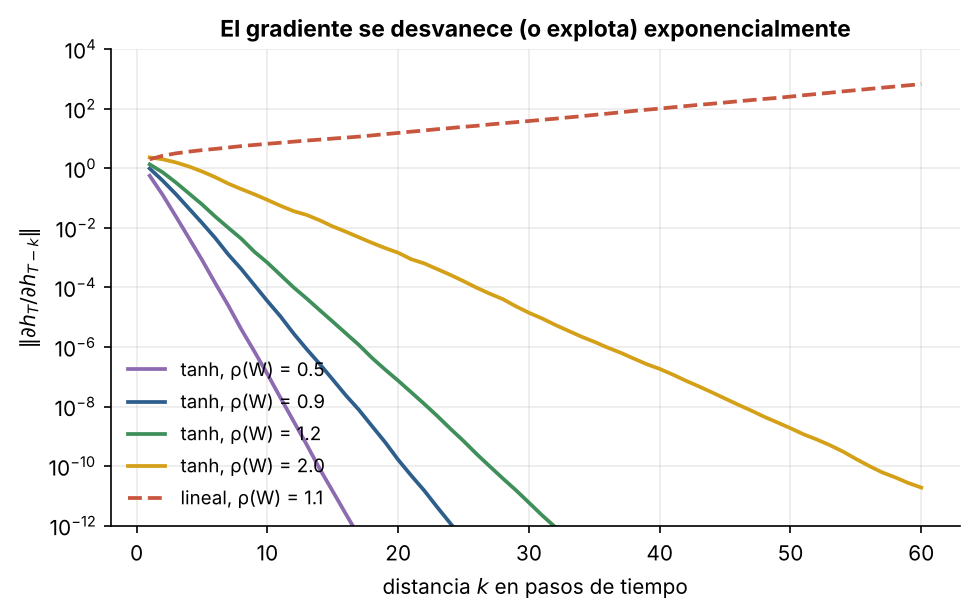
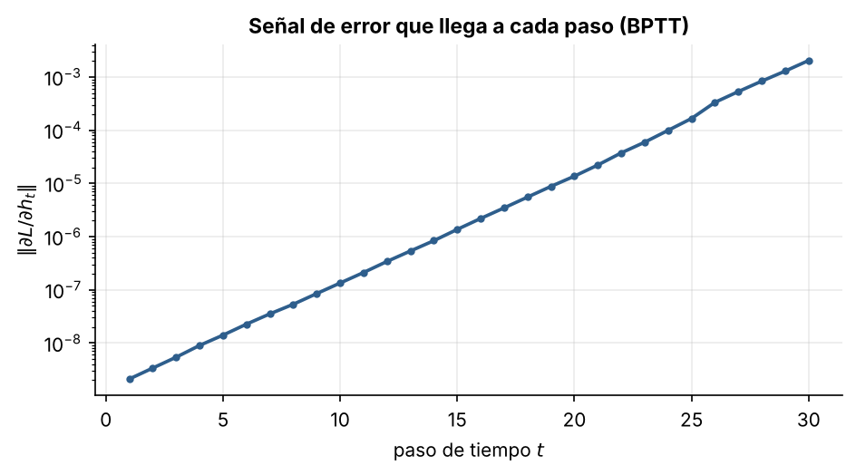
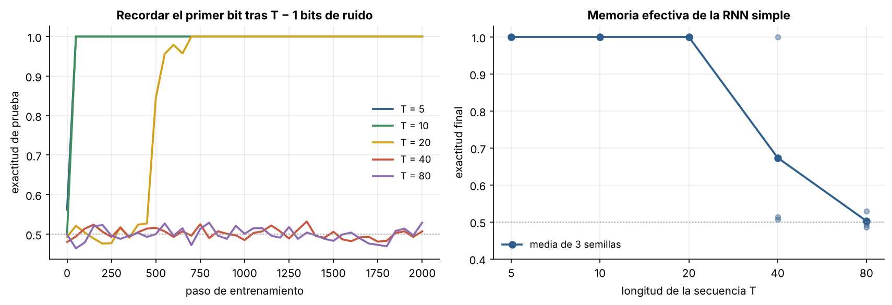

# 2.4 Redes recurrentes de Elman y el gradiente que se desvanece

[Índice](../../README.md) · [Anterior: 2.3 Hopfield](../2.3-hopfield/) · [Siguiente: 2.5 LSTM](../2.5-lstm/)

## Objetivos

- Implementar una red recurrente simple y su entrenamiento con retropropagación a través del tiempo (BPTT).
- Medir cómo se desvanece o explota el gradiente con la distancia temporal.
- Ver el efecto en una tarea de memoria: recordar el primer elemento de una secuencia.

## Contexto

Para procesar secuencias, Michael Jordan (1986) y Jeffrey Elman (1990) propusieron redes con un **estado oculto** que se realimenta: en cada paso, la red combina la entrada actual con un resumen de todo lo anterior, usando siempre los mismos pesos. Así una red de tamaño fijo procesa secuencias de cualquier longitud. Elman la usó para mostrar que una red podía descubrir por sí sola estructura gramatical en secuencias de palabras.

Para entrenarla se "desenrolla" la red en el tiempo, como si fuera una red profunda con una capa por paso y pesos compartidos, y se aplica retropropagación. Es la **retropropagación a través del tiempo** (Werbos, 1990).

El problema apareció pronto. Sepp Hochreiter lo analizó en su tesis de diploma de 1991 y Bengio, Simard y Frasconi lo formalizaron en 1994: el error que llega a pasos lejanos se desvanece o explota exponencialmente.

## Formalización

$$
\mathbf h_t = \tanh(W \mathbf h_{t-1} + U \mathbf x_t + \mathbf b), \qquad \hat y = \sigma(\mathbf v^\top \mathbf h_T + c).
$$

Por la regla de la cadena, la sensibilidad del estado final respecto a uno anterior es un producto de jacobianos:

$$
\frac{\partial \mathbf h_T}{\partial \mathbf h_t} = \prod_{k=t+1}^{T} \operatorname{diag}\big(1 - \mathbf h_k^2\big)\, W.
$$

Si la norma de cada factor es menor que 1, el producto decae como $\gamma^{T-t}$; si es mayor, crece igual de rápido. La señal de error que corrige los pesos a partir de lo que pasó en el paso $t$ es proporcional a este producto. Con $\tanh$, la saturación ($1 - h^2 \approx 0$) empuja casi siempre hacia el desvanecimiento, incluso cuando el radio espectral $\rho(W)$ es mayor que 1.

**Tarea del primer bit.** La entrada es una secuencia de $T$ bits aleatorios en $\{-1, +1\}$. Al final, la red debe decir cuál era el **primero**. Los otros $T - 1$ bits son ruido que la red debe ignorar. La única señal de entrenamiento está en el último paso, así que el gradiente debe recorrer $T$ pasos hacia atrás para enseñarle a la red qué guardar.

## Implementación

[`rnn_elman.py`](rnn_elman.py) contiene `RNNElman` (pasada hacia adelante y BPTT a mano), `SGDConMomento` con recorte de la norma del gradiente, la tarea `tarea_primer_bit` y `entrenar`, que la sección [2.5](../2.5-lstm/) reutiliza. Al ejecutarlo entrena con $T = 10$ y $T = 40$.

Se usa descenso de gradiente con momento y no Adam a propósito: Adam reescala cada gradiente por su magnitud histórica y compensa en parte el desvanecimiento, lo que esconde el fenómeno que queremos observar.

```bash
python capitulo-2/2.4-rnn-elman/rnn_elman.py
```

## Resultados

Para una red de 64 unidades con pesos aleatorios, la norma de $\partial \mathbf h_T / \partial \mathbf h_{T-k}$ cae varios órdenes de magnitud en pocas decenas de pasos para todos los radios espectrales con $\tanh$. Una red lineal con $\rho(W) = 1.1$ muestra el caso opuesto: la norma explota.



En la red sin entrenar, la señal de error que llega al primer paso de una secuencia de 30 es unas $10^{6}$ veces más débil que la que llega al último.



En la tarea del primer bit, la red aprende sin problema hasta $T = 20$. Con $T = 40$ lo logra en una de tres semillas y con $T = 80$ en ninguna: se queda en el 50 %, que es el azar.



## Lo que queda pendiente

La red tiene memoria en principio (su estado podría guardar el bit indefinidamente), pero el gradiente no le llega para aprender a usarla. Hace falta un camino por el que el error pueda viajar hacia atrás sin multiplicarse por factores pequeños. Esa es la idea de la LSTM ([2.5](../2.5-lstm/)).

## Referencias

- Elman, J. L. (1990). Finding structure in time. *Cognitive Science*, 14(2), 179–211. https://doi.org/10.1207/s15516709cog1402_1
- Werbos, P. J. (1990). Backpropagation through time: what it does and how to do it. *Proceedings of the IEEE*, 78(10), 1550–1560. https://doi.org/10.1109/5.58337
- Bengio, Y., Simard, P. y Frasconi, P. (1994). Learning long-term dependencies with gradient descent is difficult. *IEEE Transactions on Neural Networks*, 5(2), 157–166. https://doi.org/10.1109/72.279181
- Pascanu, R., Mikolov, T. y Bengio, Y. (2013). On the difficulty of training recurrent neural networks. https://arxiv.org/abs/1211.5063
- Karpathy, A. (2015). The unreasonable effectiveness of recurrent neural networks. https://karpathy.github.io/2015/05/21/rnn-effectiveness/
- *Introduction to Neural Network Models of Cognition*, capítulo «The Recurrent Neural Network». https://com-cog-book.github.io/com-cog-book/features/recurrent-net.html
