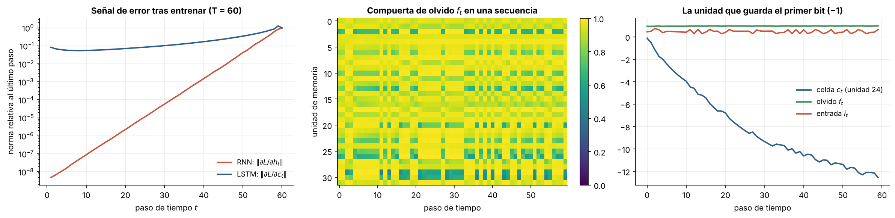
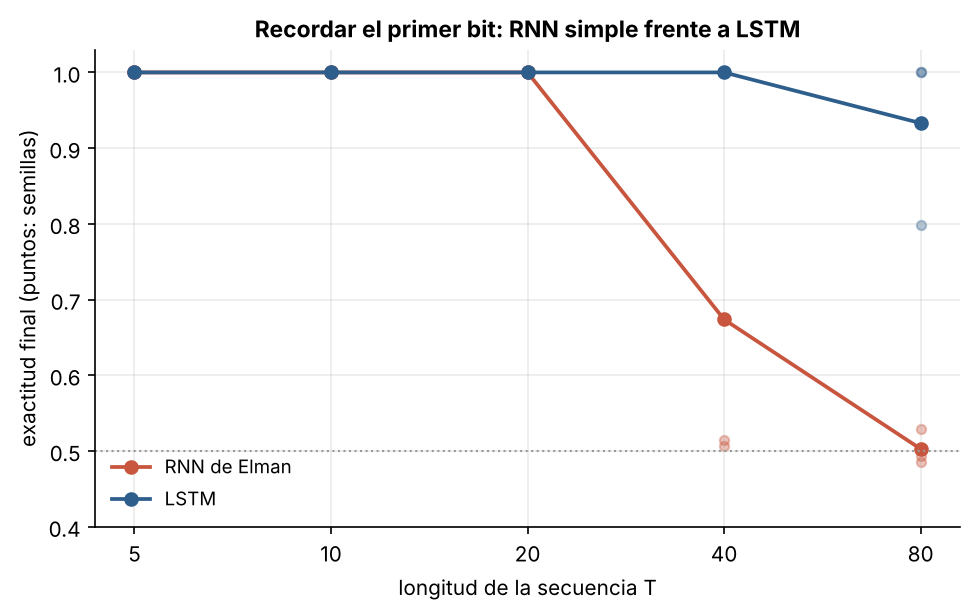

# 2.5 LSTM: aprender a recordar

[Índice](../../README.md) · [Anterior: 2.4 RNN de Elman](../2.4-rnn-elman/) · [Siguiente: 3.1 Activaciones e inicialización](../../capitulo-3/3.1-activaciones-e-inicializacion/)

## Objetivos

- Implementar una LSTM con su retropropagación a través del tiempo, solo con NumPy.
- Ver por qué la celda de memoria deja pasar el gradiente donde la RNN simple lo pierde.
- Comparar ambas redes en la tarea del primer bit de [2.4](../2.4-rnn-elman/) e inspeccionar las compuertas.

## Contexto

Sepp Hochreiter y Jürgen Schmidhuber publicaron la *Long Short-Term Memory* en 1997, como respuesta directa al análisis del gradiente que se desvanece. La idea central es una **celda de memoria** cuyo contenido se actualiza sumando, no multiplicando por una matriz y pasando por una saturación. Los autores la llamaron "carrusel de error constante": por esa vía el error puede viajar hacia atrás muchos pasos sin encogerse.

Alrededor de la celda hay **compuertas** multiplicativas, también aprendidas, que deciden qué se escribe, qué se lee y, desde Gers, Schmidhuber y Cummins (2000), qué se olvida. La LSTM dominó el reconocimiento de voz, la traducción automática y el modelado de lenguaje hasta 2017. La GRU (Cho et al., 2014) simplificó el diseño a dos compuertas con resultados parecidos.

## Formalización

Con $\mathbf a_t = W_x \mathbf x_t + W_h \mathbf h_{t-1} + \mathbf b$ dividido en cuatro bloques:

$$
\begin{aligned}
\mathbf i_t &= \sigma(\mathbf a^{(i)}_t), & \mathbf f_t &= \sigma(\mathbf a^{(f)}_t), & \mathbf o_t &= \sigma(\mathbf a^{(o)}_t), & \mathbf g_t &= \tanh(\mathbf a^{(g)}_t),\\
\mathbf c_t &= \mathbf f_t \odot \mathbf c_{t-1} + \mathbf i_t \odot \mathbf g_t, & \mathbf h_t &= \mathbf o_t \odot \tanh(\mathbf c_t).
\end{aligned}
$$

La línea que importa es la de $\mathbf c_t$. Su derivada respecto a la celda anterior por el camino directo es

$$
\frac{\partial \mathbf c_t}{\partial \mathbf c_{t-1}} = \operatorname{diag}(\mathbf f_t),
$$

sin matriz de pesos y sin derivada de una saturación. Si la red aprende a mantener $\mathbf f_t \approx 1$ y $\mathbf i_t \approx 0$ mientras no haya nada nuevo que guardar, el contenido y el gradiente atraviesan la secuencia casi intactos.

Un detalle práctico: el sesgo de la compuerta de olvido se inicializa positivo (aquí, 3) para que al empezar el entrenamiento la red tienda a recordar. Con sesgo 0 la compuerta empieza en 0.5 y el gradiente se desvanece como en una RNN simple.

## Implementación

[`lstm.py`](lstm.py) define la clase `LSTM`, con la pasada hacia adelante y BPTT a mano. Importa de [2.4](../2.4-rnn-elman/) la tarea, el optimizador y el entrenamiento. Al ejecutarlo entrena con $T = 60$.

```bash
python capitulo-2/2.5-lstm/lstm.py
```

## Resultados

Los gradientes analíticos coinciden con los numéricos (error relativo máximo del orden de $10^{-7}$).

Con $T = 60$, la RNN queda en el azar (51 %) y la LSTM llega al 100 %. El panel izquierdo explica por qué: tras el entrenamiento, el error en la celda de la LSTM cae apenas un orden de magnitud a lo largo de 60 pasos, mientras que en la RNN cae ocho. El panel central muestra la compuerta de olvido de las 32 unidades: la mayoría se mantiene cerca de 1 durante casi toda la secuencia. El derecho sigue a la unidad que guarda el bit: la compuerta de olvido se mantiene en 1 y la celda acumula una señal con el signo del primer bit.



En el barrido, la LSTM resuelve la tarea en todas las semillas hasta $T = 40$ y en dos de tres con $T = 80$ (la tercera llega al 80 %). La RNN simple falla desde $T = 40$.



## Lo que queda pendiente

- **Secuencialidad.** Para calcular $\mathbf h_{100}$ hay que calcular antes $\mathbf h_{99}$. El entrenamiento no se puede paralelizar a lo largo de la secuencia y las GPU, que dependen del paralelismo masivo, quedan infrautilizadas.
- **Estado de tamaño fijo.** Todo el pasado debe caber en un vector. En traducción, eso significa comprimir una oración entera en unos cientos de números ([3.3](../../capitulo-3/3.3-seq2seq-y-atencion/)).

Dos ideas de esta sección volverán más adelante. La suma como autopista para el gradiente reaparece en las conexiones residuales ([3.2](../../capitulo-3/3.2-redes-residuales/)). Las compuertas que dependen de la entrada reaparecen en el mecanismo de selección de Mamba ([5.3](../../capitulo-5/5.3-mamba/)).

## Referencias

- Hochreiter, S. y Schmidhuber, J. (1997). Long short-term memory. *Neural Computation*, 9(8), 1735–1780. https://doi.org/10.1162/neco.1997.9.8.1735
- Gers, F. A., Schmidhuber, J. y Cummins, F. (2000). Learning to forget: continual prediction with LSTM. *Neural Computation*, 12(10), 2451–2471. https://doi.org/10.1162/089976600300015015
- Cho, K. et al. (2014). Learning phrase representations using RNN encoder-decoder for statistical machine translation. https://arxiv.org/abs/1406.1078
- Jozefowicz, R., Zaremba, W. y Sutskever, I. (2015). An empirical exploration of recurrent network architectures. *ICML*. https://proceedings.mlr.press/v37/jozefowicz15.html
- Olah, C. (2015). Understanding LSTM networks. https://colah.github.io/posts/2015-08-Understanding-LSTMs/
