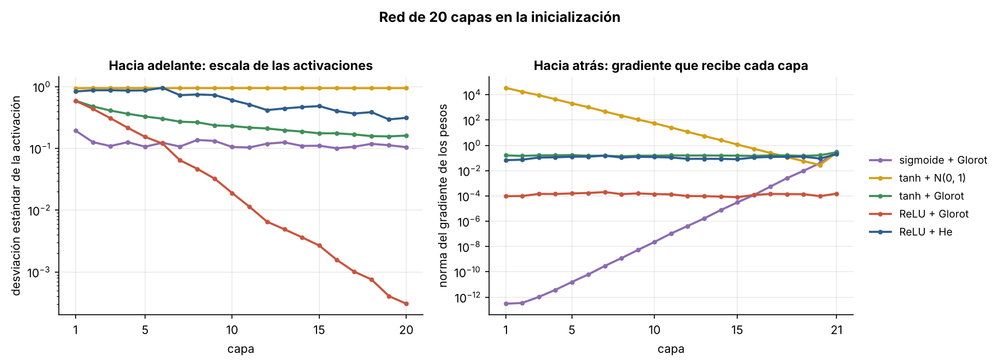
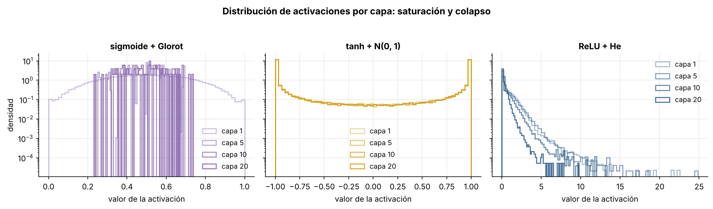
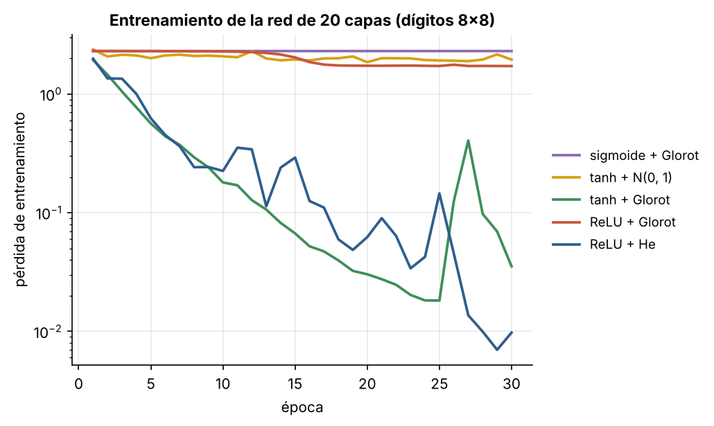

# 3.1 Activaciones e inicialización: por qué las redes profundas no entrenaban

[Índice](../../README.md) · [Anterior: 2.5 LSTM](../../capitulo-2/2.5-lstm/) · [Siguiente: 3.2 Redes residuales](../3.2-redes-residuales/)

## Objetivos

- Medir capa por capa la escala de las activaciones y de los gradientes en una red de 20 capas.
- Entender por qué la sigmoide desvanece el gradiente y por qué una inicialización mal escalada lo hace explotar o colapsar.
- Ver que con ReLU y la inicialización de He la misma red profunda entrena sin problemas.

## Contexto

Entre 1995 y 2005 las redes neuronales pasaron de moda. Las máquinas de vectores de soporte (Cortes y Vapnik, 1995) y otros métodos de kernel ofrecían optimización convexa, garantías teóricas y buen rendimiento con los datos de la época. Unos pocos grupos siguieron trabajando con redes: Hinton en Toronto, LeCun en Nueva York, Bengio en Montreal, Schmidhuber en Lugano. En 2006, Hinton, Osindero y Teh mostraron que se podía preentrenar una red profunda capa por capa, y la comunidad empezó a hablar de *deep learning*.

El cambio de escala llegó en 2012. AlexNet (Krizhevsky, Sutskever y Hinton) ganó la competencia ImageNet con un error top-5 de 15.3 %, frente al 26.2 % del segundo lugar. La arquitectura era una red convolucional al estilo de LeNet, más grande. Lo nuevo era el entorno: más de un millón de imágenes etiquetadas, GPU programables y un conjunto de técnicas de entrenamiento, entre ellas la activación **ReLU** y el **dropout**. Poco antes, Glorot y Bengio (2010) habían explicado cómo escalar la inicialización para que la señal no se degrade al atravesar muchas capas, y He y colaboradores (2015) adaptaron esa regla a ReLU.

La lección de esa época es que muchos problemas que parecían de arquitectura eran de **entrenabilidad**. Las ideas de 1989 funcionaban; faltaban los datos, el hardware y los detalles.

## Formalización

En una capa $\mathbf h_{\ell} = \phi(W_\ell \mathbf h_{\ell-1})$ con $n$ entradas y pesos independientes de varianza $\sigma_w^2$, la varianza de la preactivación es aproximadamente $n\,\sigma_w^2\, \mathbb E[\phi(\cdot)^2]$. Para que la escala se mantenga capa tras capa:

| Activación | Regla | Varianza de los pesos |
|---|---|---|
| tanh (lineal cerca de 0) | Glorot | $\sigma_w^2 = 2/(n_{\text{entrada}} + n_{\text{salida}})$ |
| ReLU (anula la mitad) | He | $\sigma_w^2 = 2/n_{\text{entrada}}$ |

Hacia atrás, el gradiente se multiplica en cada capa por $W_\ell^\top$ y por la derivada de la activación. La derivada de la sigmoide vale como máximo $1/4$, así que veinte capas pueden encoger el gradiente en un factor de hasta $4^{-20} \approx 10^{-12}$. La derivada de ReLU es exactamente 1 donde la unidad está activa.

## Implementación

[`activaciones_e_inicializacion.py`](activaciones_e_inicializacion.py) usa PyTorch a partir de aquí: la diferenciación automática reemplaza las derivadas escritas a mano. `construir` arma una red de 20 capas de 64 unidades con la activación y la inicialización indicadas, y `entrenar` la ajusta con descenso de gradiente con momento sobre los dígitos de 8×8. Al ejecutarlo compara sigmoide con Glorot frente a ReLU con He.

```bash
python capitulo-3/3.1-activaciones-e-inicializacion/activaciones_e_inicializacion.py
```

## Resultados

Hacia adelante, con ReLU e inicialización de Glorot las activaciones se encogen en un factor cercano a $1/\sqrt{2}$ por capa: en la capa 20 su desviación estándar es $3 \times 10^{-4}$. Con ReLU y He, y con tanh y Glorot, la escala se mantiene. Con tanh y pesos $N(0, 1)$ la mayoría de las unidades están saturadas en $\pm 1$.

Hacia atrás, con sigmoide la primera capa recibe un gradiente $10^{-11}$ veces menor que la última. Con tanh y pesos $N(0,1)$ ocurre lo contrario: la primera capa recibe un gradiente un millón de veces mayor.



Los histogramas muestran las dos formas de fallar: con tanh y $N(0,1)$ las activaciones se acumulan en $\pm 1$, donde la derivada es cero; con sigmoide quedan todas cerca de 0.5 y la red apenas distingue entradas distintas.



El entrenamiento confirma el diagnóstico. Sigmoide y tanh con $N(0,1)$ no aprenden nada en 30 épocas (pérdida 2.30 y 1.95; el azar es $\ln 10 \approx 2.30$). ReLU con Glorot avanza muy despacio. Tanh con Glorot y ReLU con He bajan la pérdida a 0.035 y 0.010.



## Lo que queda pendiente

Con buena inicialización y ReLU se pueden entrenar redes de unas veinte capas. Pero al apilar muchas más aparece un problema distinto: redes más profundas que entrenan **peor** que redes menos profundas, aunque en teoría podrían copiarlas. No es sobreajuste; es optimización ([3.2](../3.2-redes-residuales/)).

## Referencias

- Glorot, X. y Bengio, Y. (2010). Understanding the difficulty of training deep feedforward neural networks. *AISTATS*. https://proceedings.mlr.press/v9/glorot10a.html
- Nair, V. y Hinton, G. E. (2010). Rectified linear units improve restricted Boltzmann machines. *ICML*.
- He, K., Zhang, X., Ren, S. y Sun, J. (2015). Delving deep into rectifiers. https://arxiv.org/abs/1502.01852
- Krizhevsky, A., Sutskever, I. y Hinton, G. (2012). ImageNet classification with deep convolutional neural networks. *NeurIPS*. https://papers.nips.cc/paper/2012/hash/c399862d3b9d6b76c8436e924a68c45b-Abstract.html
- Srivastava, N. et al. (2014). Dropout: a simple way to prevent neural networks from overfitting. *JMLR*, 15, 1929–1958. https://jmlr.org/papers/v15/srivastava14a.html
- Hinton, G. E., Osindero, S. y Teh, Y. W. (2006). A fast learning algorithm for deep belief nets. *Neural Computation*, 18(7), 1527–1554. https://doi.org/10.1162/neco.2006.18.7.1527
