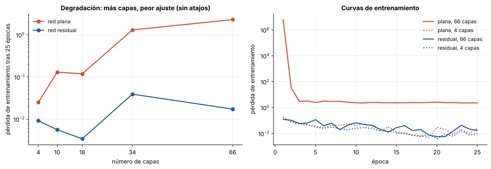
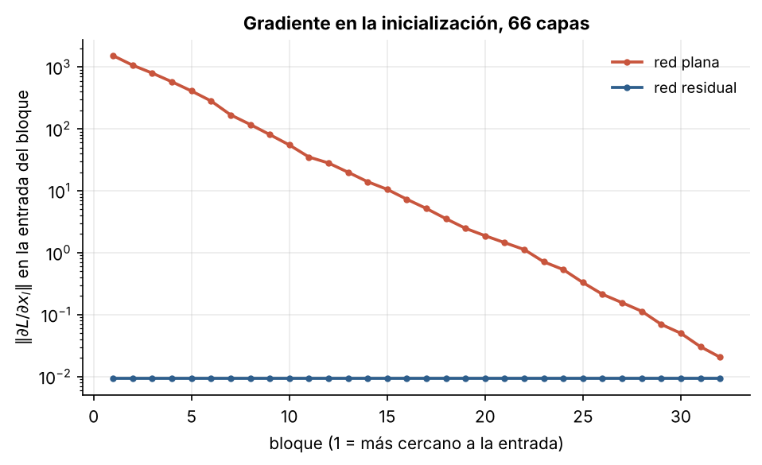

# 3.2 Redes residuales

[Índice](../../README.md) · [Anterior: 3.1 Activaciones e inicialización](../3.1-activaciones-e-inicializacion/) · [Siguiente: 3.3 Seq2seq y atención](../3.3-seq2seq-y-atencion/)

## Objetivos

- Reproducir el problema de la degradación: redes más profundas que ajustan peor los datos de entrenamiento.
- Implementar bloques residuales y comprobar que lo resuelven.
- Ver el flujo del gradiente en una red plana y en una residual de 66 capas.

## Contexto

Con ReLU, buena inicialización y normalización por lotes (Ioffe y Szegedy, 2015) se podían entrenar redes de unas veinte capas. Al apilar más aparecía algo desconcertante: una red plana de 56 capas tenía **mayor error de entrenamiento** que una de 20. No era sobreajuste, que empeoraría solo el error de prueba. Era un problema de optimización: la red profunda podría imitar a la menos profunda poniendo sus capas extra como identidad, pero el descenso de gradiente no encontraba esa solución.

Kaiming He, Xiangyu Zhang, Shaoqing Ren y Jian Sun (Microsoft Research Asia, 2015) propusieron que cada bloque aprenda solo una **corrección** sobre su entrada. Con esa idea entrenaron redes de 152 capas y ganaron ImageNet 2015 con un error top-5 de 3.57 %. Meses antes, las *Highway Networks* de Srivastava, Greff y Schmidhuber habían propuesto un atajo con compuertas inspiradas directamente en la LSTM.

El "flujo residual" de esta sección es la columna vertebral de todos los Transformers. Durante una década casi nadie lo modificó; en 2026, DeepSeek-V4 lo reemplazó por hiperconexiones con restricciones (mHC), una de las primeras modificaciones serias de esta pieza.

## Formalización

Un bloque residual calcula

$$
\mathbf x_{\ell+1} = \mathbf x_\ell + F(\mathbf x_\ell),
$$

donde $F$ son dos capas con normalización y ReLU. Si lo mejor es no hacer nada, basta con que $F \approx 0$. Al derivar, la identidad aparece en cada término:

$$
\frac{\partial \mathbf x_L}{\partial \mathbf x_\ell} = I + \frac{\partial}{\partial \mathbf x_\ell} \sum_{i=\ell}^{L-1} F(\mathbf x_i),
$$

así que el gradiente siempre tiene una ruta directa desde la salida hasta cualquier capa, igual que el carrusel de error de la LSTM ([2.5](../../capitulo-2/2.5-lstm/)).

Un detalle de implementación ayuda mucho: inicializar en cero la escala de la última normalización de cada bloque. Así cada bloque empieza siendo exactamente la identidad y la red profunda arranca comportándose como una red de una capa (Goyal et al., 2017).

## Implementación

[`redes_residuales.py`](redes_residuales.py) define `Bloque`, plano o residual, y `Red`. Al ejecutarlo entrena las dos versiones con 32 bloques (66 capas lineales) sobre los dígitos de 8×8.

```bash
python capitulo-3/3.2-redes-residuales/redes_residuales.py
```

## Resultados

La red plana empeora con la profundidad: su pérdida de entrenamiento final pasa de 0.025 con 4 capas a 1.31 con 34 y a 2.30 con 66, que es no haber aprendido nada. Las redes residuales se mantienen entre 0.003 y 0.04 en todas las profundidades. A la derecha, la red plana de 66 capas empieza con una pérdida enorme (las activaciones explotan en la primera época) y se estanca.



La causa se ve en el gradiente. En la red plana de 66 capas, el gradiente que llega a la entrada de cada bloque crece unos cinco órdenes de magnitud del último bloque al primero: la combinación de normalización por lotes y ReLU sin atajos lo hace explotar hacia atrás. En la red residual es el mismo en todos los bloques.



## Lo que queda pendiente

Con conexiones residuales la profundidad deja de ser un problema en visión. El siguiente cuello de botella estaba en el lenguaje y la traducción, que seguían en manos de redes recurrentes con un estado de tamaño fijo ([3.3](../3.3-seq2seq-y-atencion/)).

## Referencias

- He, K., Zhang, X., Ren, S. y Sun, J. (2015). Deep residual learning for image recognition. https://arxiv.org/abs/1512.03385
- Srivastava, R. K., Greff, K. y Schmidhuber, J. (2015). Highway networks. https://arxiv.org/abs/1505.00387
- Ioffe, S. y Szegedy, C. (2015). Batch normalization. https://arxiv.org/abs/1502.03167
- Goyal, P. et al. (2017). Accurate, large minibatch SGD: training ImageNet in 1 hour. https://arxiv.org/abs/1706.02677
- Yang, G. et al. (2019). A mean field theory of batch normalization. https://arxiv.org/abs/1902.08129
- Xie, Z. et al. (2025). mHC: Manifold-constrained hyper-connections. https://arxiv.org/abs/2512.24880
