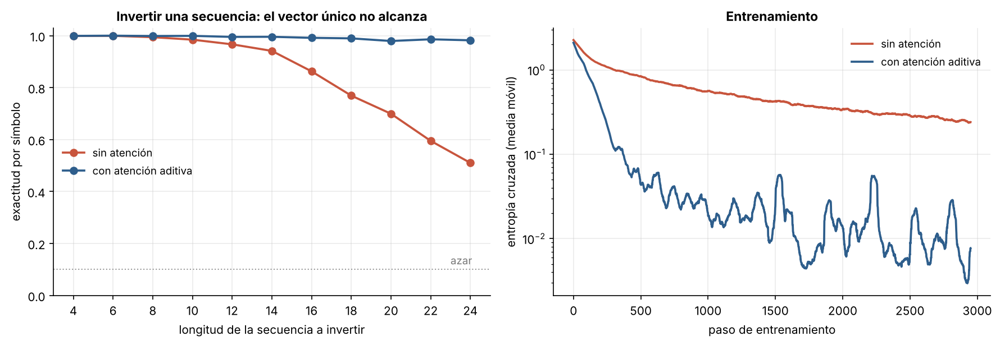
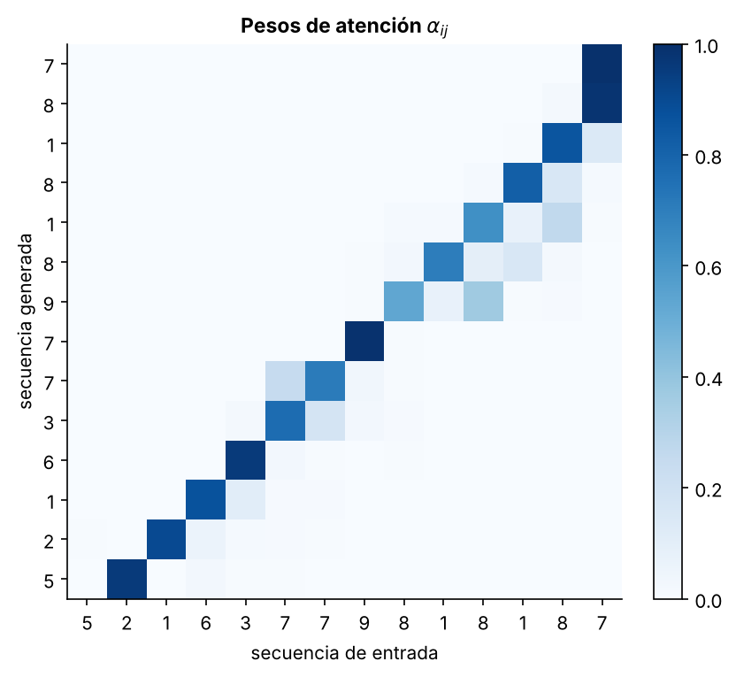

# 3.3 Secuencia a secuencia y atención

[Índice](../../README.md) · [Anterior: 3.2 Redes residuales](../3.2-redes-residuales/) · [Siguiente: 4.1 Autoatención y Transformer](../../capitulo-4/4.1-autoatencion-y-transformer/)

## Objetivos

- Implementar un modelo codificador-decodificador con GRU.
- Medir cómo empeora cuando toda la entrada debe caber en un solo vector.
- Añadir atención aditiva y visualizar qué parte de la entrada consulta el decodificador en cada paso.

## Contexto

En 2014, Sutskever, Vinyals y Le (Google) y Cho y colaboradores (Montreal) propusieron el esquema **codificador-decodificador** para traducción automática: una red recurrente lee la oración de origen y la resume en su último estado oculto; otra, partiendo de ese vector, genera la traducción palabra a palabra. Funcionó mejor de lo que casi nadie esperaba, pero la calidad caía con las oraciones largas. Todo el significado, fuera de cinco o de cincuenta palabras, debía caber en un vector de tamaño fijo.

Bahdanau, Cho y Bengio propusieron ese mismo año la solución: que el decodificador, en cada paso, **consulte todos los estados del codificador** y haga un promedio ponderado con pesos que él mismo calcula. Ya no hay que comprimir: la memoria crece con la entrada. Luong, Pham y Manning (2015) estudiaron variantes, entre ellas la que se usa aquí, en la que la consulta es el estado del decodificador ya actualizado.

## Formalización

El codificador produce estados $\mathbf h_1, \dots, \mathbf h_n$. En el paso $t$, el decodificador actualiza su estado $\mathbf s_t$ con el símbolo anterior y calcula una puntuación para cada posición de la entrada:

$$
e_{tj} = \mathbf v^\top \tanh(W_s \mathbf s_t + W_h \mathbf h_j), \qquad
\alpha_{tj} = \frac{\exp(e_{tj})}{\sum_k \exp(e_{tk})}, \qquad
\mathbf c_t = \sum_j \alpha_{tj}\, \mathbf h_j.
$$

La predicción usa $[\mathbf s_t; \mathbf c_t]$. Los pesos $\alpha_{tj}$ forman una distribución sobre las posiciones de la entrada: es una búsqueda **suave y diferenciable** en una memoria. El modelo sin atención solo dispone de $\mathbf s_t$, que nace del último estado del codificador.

**Tarea.** Invertir una secuencia de dígitos de longitud entre 4 y 24. Es trivial para un humano y difícil para un vector fijo: la primera salida es el último símbolo leído, pero la última salida es el primero, que el codificador vio hace muchos pasos.

## Implementación

[`seq2seq_atencion.py`](seq2seq_atencion.py) define `Seq2Seq`: codificador GRU, decodificador `GRUCell` y, opcionalmente, atención aditiva. Incluye la tarea de inversión de secuencias, el entrenamiento y `exactitud_por_longitud`. Al ejecutarlo entrena ambos modelos y mide la exactitud con longitudes 8, 16 y 24.

```bash
python capitulo-3/3.3-seq2seq-y-atencion/seq2seq_atencion.py
```

## Resultados

Sin atención, la exactitud por símbolo es perfecta para secuencias cortas y cae a medida que crecen: 94 % con 14 símbolos, 70 % con 20 y 51 % con 24. Con atención se mantiene por encima del 98 % en todas las longitudes. La pérdida de entrenamiento final es 0.25 sin atención y 0.006 con ella.



El mapa de atención es casi una antidiagonal: para generar el primer símbolo el decodificador mira la última posición de la entrada, para el segundo la penúltima, y así sucesivamente. Nadie le dijo al modelo que la tarea era invertir; la alineación emerge del entrenamiento. En traducción, estos mismos mapas muestran qué palabra de origen corresponde a cada palabra traducida.



## Lo que queda pendiente

La atención resuelve el cuello de botella, pero debajo sigue habiendo dos redes recurrentes que procesan los símbolos uno detrás de otro. Si la atención es lo que funciona, ¿hace falta la recurrencia? ([4.1](../../capitulo-4/4.1-autoatencion-y-transformer/)).

## Referencias

- Sutskever, I., Vinyals, O. y Le, Q. V. (2014). Sequence to sequence learning with neural networks. https://arxiv.org/abs/1409.3215
- Cho, K. et al. (2014). Learning phrase representations using RNN encoder-decoder for statistical machine translation. https://arxiv.org/abs/1406.1078
- Bahdanau, D., Cho, K. y Bengio, Y. (2014). Neural machine translation by jointly learning to align and translate. https://arxiv.org/abs/1409.0473
- Luong, M.-T., Pham, H. y Manning, C. D. (2015). Effective approaches to attention-based neural machine translation. https://arxiv.org/abs/1508.04025
- Alammar, J. Visualizing a neural machine translation model. https://jalammar.github.io/visualizing-neural-machine-translation-mechanics-of-seq2seq-models-with-attention/
- Olah, C. y Carter, S. (2016). Attention and augmented recurrent neural networks. *Distill*. https://distill.pub/2016/augmented-rnns/
