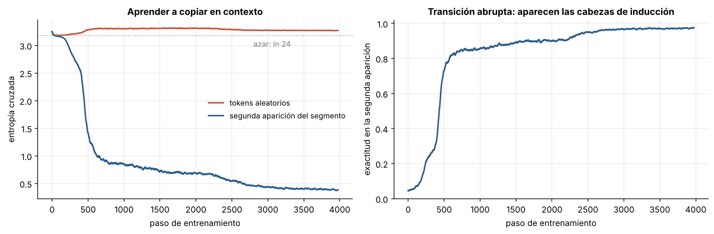
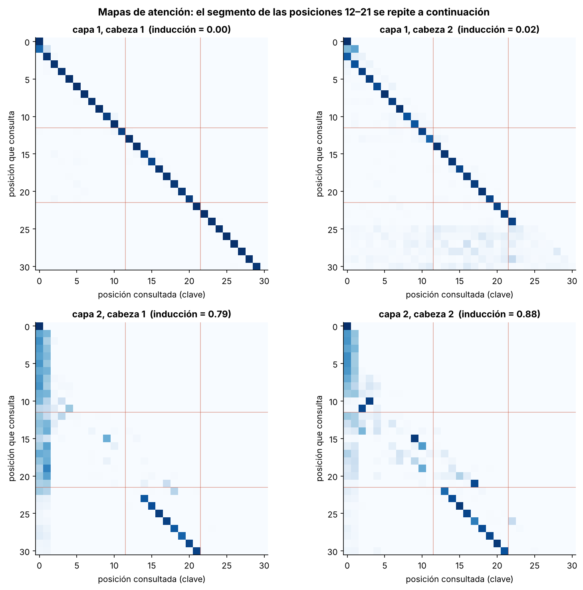

# 4.1 Autoatención y el Transformer

[Índice](../../README.md) · [Anterior: 3.3 Seq2seq y atención](../../capitulo-3/3.3-seq2seq-y-atencion/) · [Siguiente: 4.2 Costo y caché KV](../4.2-costo-y-cache-kv/)

## Objetivos

- Implementar desde cero la atención multicabeza causal y un Transformer decodificador pequeño.
- Entrenarlo en una tarea de copia en contexto y observar una transición abrupta durante el aprendizaje.
- Identificar en los mapas de atención las **cabezas de inducción**, el mecanismo detrás del aprendizaje en contexto.

## Contexto

En 2017, Ashish Vaswani y siete coautores de Google publicaron *Attention Is All You Need*. La pregunta era directa: si la atención es lo que funciona en traducción, ¿para qué la recurrencia? El Transformer la elimina por completo. Cada símbolo de la secuencia consulta directamente a todos los demás, todos a la vez.

Eso resolvía los dos problemas de las redes recurrentes. El entrenamiento se paraleliza a lo largo de la secuencia, que es justo lo que las GPU hacen bien, y la información entre dos posiciones cualesquiera recorre un solo paso, no $n$. El precio es un costo cuadrático en la longitud ([4.2](../4.2-costo-y-cache-kv/)).

El Transformer fue la base de BERT y GPT (2018), de las leyes de escala (Kaplan et al., 2020) y de prácticamente todos los modelos de lenguaje posteriores. Olsson y colaboradores (2022) identificaron uno de sus mecanismos centrales: las cabezas de inducción, que implementan la regla "busca la vez anterior que apareció el símbolo actual y copia lo que vino después".

## Formalización

Para una secuencia $X \in \mathbb R^{n \times d}$ y una cabeza de dimensión $d_k$:

$$
Q = XW_Q, \quad K = XW_K, \quad V = XW_V, \qquad
\operatorname{Atencion}(Q, K, V) = \operatorname{softmax}\!\left(\frac{QK^\top}{\sqrt{d_k}} + M\right) V,
$$

donde $M_{ij} = -\infty$ si $j > i$ (máscara causal: nadie mira el futuro). Cada símbolo emite una *consulta* (qué busca), una *clave* (qué ofrece) y un *valor* (qué entrega si lo eligen). Con varias cabezas en paralelo, cada una aprende un tipo de relación distinto.

Un bloque aplica, con conexiones residuales y normalización previa,

$$
\mathbf x \leftarrow \mathbf x + \operatorname{Atencion}(\operatorname{LN}(\mathbf x)), \qquad
\mathbf x \leftarrow \mathbf x + \operatorname{MLP}(\operatorname{LN}(\mathbf x)).
$$

La atención no sabe en qué orden están los símbolos (trata la entrada como un conjunto), así que se suma una incrustación de posición aprendida.

**Tarea de copia en contexto.** Una secuencia de 32 símbolos aleatorios contiene un segmento que se repite inmediatamente después. Tanto la longitud del segmento (de 5 a 12) como su posición son aleatorias. En la segunda aparición, cada símbolo se puede predecir si el modelo encuentra dónde apareció antes el símbolo actual y copia el siguiente. Ninguna regla basada solo en posiciones funciona.

## Implementación

[`transformer.py`](transformer.py) define `AtencionMulticabeza` (con caché KV opcional, que usa la sección [4.2](../4.2-costo-y-cache-kv/)), `Bloque` con prenormalización y `Transformer`, más la tarea de copia de segmentos. Al ejecutarlo entrena el modelo de dos capas e imprime la exactitud sobre la segunda aparición del segmento.

```bash
python capitulo-4/4.1-autoatencion-y-transformer/transformer.py
```

## Resultados

Durante los primeros 300 pasos la exactitud en la parte repetida sube despacio hasta un 25 %. Entre los pasos 400 y 550 salta a más del 80 %, y termina en 97 %. En los símbolos aleatorios la pérdida queda cerca del azar (3.27 frente a $\ln 24 \approx 3.18$), como debe ser: no hay nada que aprender ahí. Este salto brusco es la firma de la formación de las cabezas de inducción que describieron Olsson et al.



Los mapas de atención muestran el circuito completo, repartido en dos capas:

- **Capa 1:** las dos cabezas atienden a la posición inmediatamente anterior (la diagonal desplazada en uno). Cada posición copia en su representación cuál era el símbolo previo.
- **Capa 2:** dentro de la segunda aparición del segmento, cada posición atiende a la posición que, en la primera aparición, venía justo después del símbolo actual. Es la diagonal paralela desplazada en la longitud del segmento. La puntuación de inducción (peso promedio sobre esa diagonal) es 0.79 y 0.88.

La capa 2 puede hacer esa búsqueda porque la capa 1 dejó en cada posición la identidad del símbolo anterior: la consulta "¿quién tiene como símbolo previo el mismo que yo?" se resuelve comparando claves.



## Lo que queda pendiente

Cada símbolo compara su consulta con las claves de **todos** los anteriores. Entrenar cuesta $O(n^2)$ y, al generar, el modelo debe guardar y releer las claves y valores de todo el contexto ([4.2](../4.2-costo-y-cache-kv/)).

## Referencias

- Vaswani, A. et al. (2017). Attention is all you need. https://arxiv.org/abs/1706.03762
- Olsson, C. et al. (2022). In-context learning and induction heads. https://transformer-circuits.pub/2022/in-context-learning-and-induction-heads/index.html
- Ba, J. L., Kiros, J. R. y Hinton, G. E. (2016). Layer normalization. https://arxiv.org/abs/1607.06450
- Radford, A. et al. (2019). Language models are unsupervised multitask learners. OpenAI.
- Kaplan, J. et al. (2020). Scaling laws for neural language models. https://arxiv.org/abs/2001.08361
- Alammar, J. The illustrated transformer. https://jalammar.github.io/illustrated-transformer/
- Rush, A. et al. The annotated transformer. https://nlp.seas.harvard.edu/annotated-transformer/
- 3Blue1Brown. Attention in transformers, step-by-step. https://www.3blue1brown.com/topics/neural-networks
