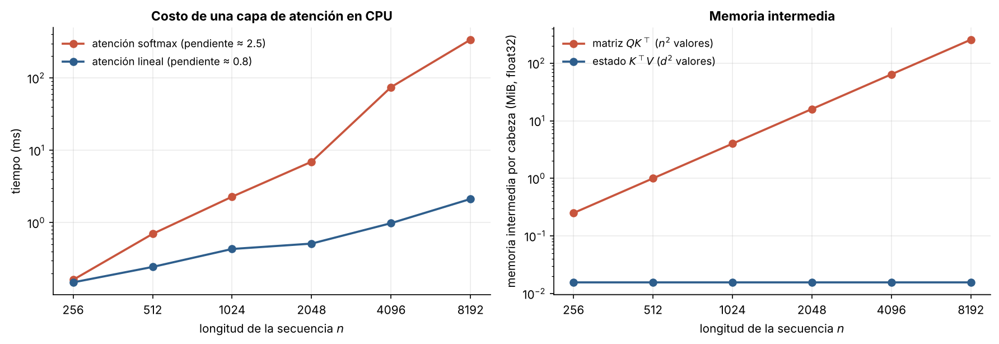
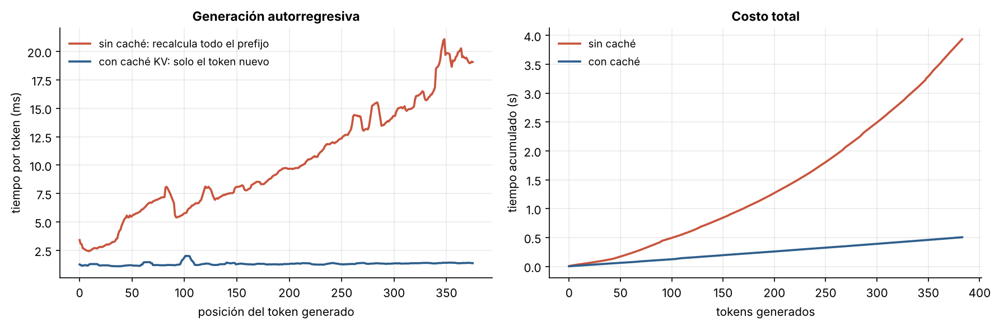
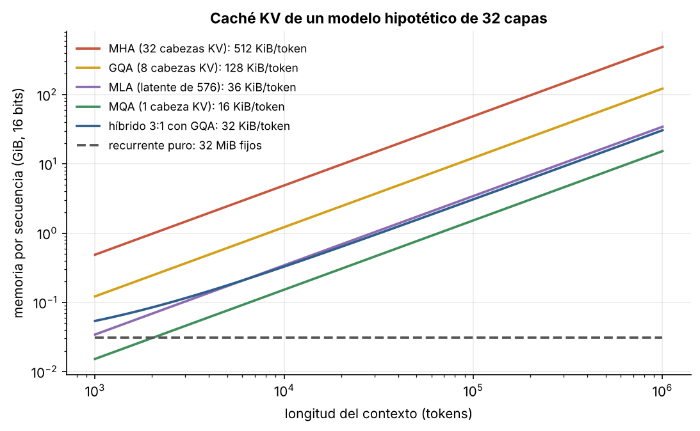

# 4.2 El costo de la atención y la caché KV

[Índice](../../README.md) · [Anterior: 4.1 Autoatención y Transformer](../4.1-autoatencion-y-transformer/) · [Siguiente: 4.3 Mezcla de expertos](../4.3-mezcla-de-expertos/)

## Objetivos

- Medir el crecimiento cuadrático del costo de la atención con la longitud de la secuencia.
- Implementar la caché de claves y valores (caché KV) y comprobar que genera exactamente lo mismo que recalcular todo.
- Calcular cuánta memoria ocupa la caché KV en distintos diseños: atención multicabeza, GQA, MQA, MLA e híbridos.

## Contexto

El Transformer ganó porque se entrena en paralelo. Pero la tabla 1 de *Attention Is All You Need* ya anunciaba el precio: una capa de autoatención cuesta $O(n^2 d)$ operaciones, frente a $O(n d^2)$ de una capa recurrente.

Al **generar** texto aparece un segundo costo. Cada símbolo nuevo necesita las claves y valores de todos los anteriores. Recalcularlos en cada paso sería absurdo, así que se guardan: es la caché KV. La caché ahorra cómputo, pero crece linealmente con el contexto, y cada símbolo nuevo debe leerla entera. Cuando los contextos pasaron de unos miles de símbolos a un millón, y los modelos de razonamiento empezaron a generar decenas de miles de símbolos por respuesta, ese costo de memoria se volvió el cuello de botella dominante.

La industria respondió encogiendo la caché: *Multi-Query Attention* (Shazeer, 2019) comparte una sola cabeza de claves y valores entre todas las consultas; *Grouped-Query Attention* (Ainslie et al., 2023) comparte una por grupo; *Multi-head Latent Attention* (DeepSeek-V2, 2024) guarda una versión comprimida de dimensión baja. Los capítulos 5 y 6 exploran la alternativa radical: reemplazar la caché por un estado de tamaño fijo.

## Formalización

Para una secuencia de $n$ símbolos, la matriz $QK^\top$ tiene $n^2$ entradas: tiempo y memoria intermedia cuadráticos. La atención lineal ([5.1](../../capitulo-5/5.1-atencion-lineal/)) reordena el producto como $Q(K^\top V)$, con un estado intermedio de $d \times d$.

Para un modelo con $L$ capas, $h_{kv}$ cabezas de claves y valores de dimensión $d_h$ y $b$ bytes por número, la caché KV ocupa

$$
\text{bytes por símbolo} = 2 \cdot L \cdot h_{kv} \cdot d_h \cdot b,
$$

donde el 2 cuenta claves y valores. Con $L = 32$, $h_{kv} = 32$, $d_h = 128$ y 16 bits, son 512 KiB por símbolo, y un contexto de un millón de símbolos ocupa casi 500 GiB **por conversación**.

## Implementación

[`costo_y_cache_kv.py`](costo_y_cache_kv.py) importa el Transformer de [4.1](../4.1-autoatencion-y-transformer/) y define `generar`, con y sin caché KV, y `bytes_por_token`, el tamaño de la caché para MHA, GQA, MQA y MLA. Al ejecutarlo genera 384 símbolos de las dos maneras, comprueba que coinciden e imprime la memoria de cada variante a un millón de símbolos.

```bash
python capitulo-4/4.2-costo-y-cache-kv/costo_y_cache_kv.py
```

## Resultados

En escala logarítmica, el tiempo de la atención softmax crece con pendiente 2.5 (algo más que cuadrático por los efectos de memoria caché de la CPU) y el de la lineal con pendiente 0.8. A 8192 símbolos, la matriz $QK^\top$ de una sola cabeza ocupa 256 MiB; el estado de la atención lineal, 16 KiB.



Sin caché, el tiempo por símbolo crece con la posición porque el modelo recalcula todo el prefijo; con caché se mantiene casi constante. Generar 384 símbolos toma 3.9 s sin caché y 0.5 s con ella, y las dos secuencias generadas son idénticas.



La memoria de la caché a un millón de símbolos va de 488 GiB (atención multicabeza completa) a 122 GiB (GQA con 8 cabezas), 34 GiB (MLA) y 15 GiB (MQA). Un híbrido que solo usa atención en una de cada cuatro capas baja a 31 GiB. Un modelo puramente recurrente guarda un estado fijo, aquí de 32 MiB, sin importar la longitud.



## Lo que queda pendiente

Todas estas técnicas abaratan el Transformer sin cambiar su naturaleza: el costo por símbolo sigue creciendo con el contexto. La otra palanca para escalar sin pagar más por símbolo es activar solo una parte de los parámetros ([4.3](../4.3-mezcla-de-expertos/)).

## Referencias

- Vaswani, A. et al. (2017). Attention is all you need. https://arxiv.org/abs/1706.03762
- Shazeer, N. (2019). Fast transformer decoding: one write-head is all you need. https://arxiv.org/abs/1911.02150
- Ainslie, J. et al. (2023). GQA: training generalized multi-query transformer models from multi-head checkpoints. https://arxiv.org/abs/2305.13245
- DeepSeek-AI (2024). DeepSeek-V2: a strong, economical, and efficient mixture-of-experts language model. https://arxiv.org/abs/2405.04434
- Dao, T. et al. (2022). FlashAttention: fast and memory-efficient exact attention with IO-awareness. https://arxiv.org/abs/2205.14135
- Tay, Y. et al. (2020). Efficient transformers: a survey. https://arxiv.org/abs/2009.06732
