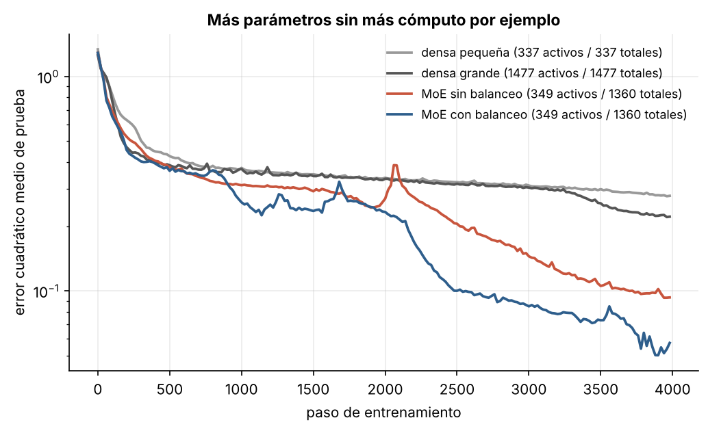
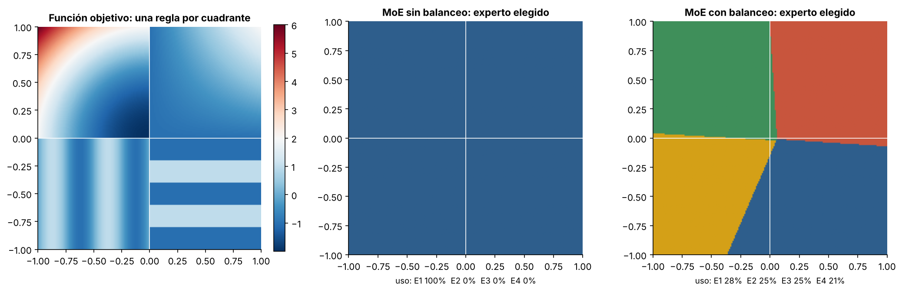
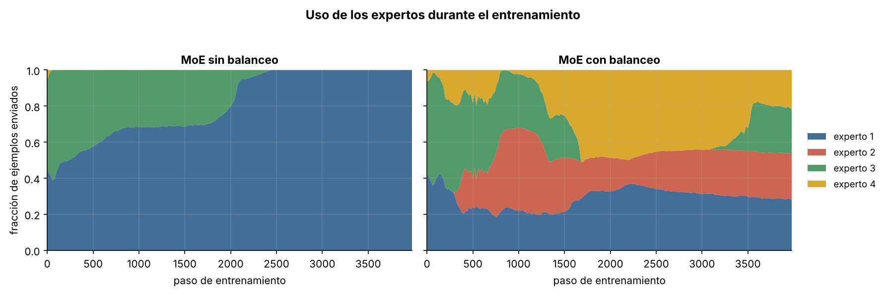

# 4.3 Mezcla de expertos

[Índice](../../README.md) · [Anterior: 4.2 Costo y caché KV](../4.2-costo-y-cache-kv/) · [Siguiente: 5.1 Atención lineal](../../capitulo-5/5.1-atencion-lineal/)

## Objetivos

- Implementar una capa de mezcla de expertos (MoE) con enrutamiento *top-1*.
- Comparar, a igual cómputo por ejemplo, una red densa con una MoE de cuatro veces más parámetros.
- Observar el colapso del enrutador y cómo lo evita una pérdida auxiliar de balanceo.

## Contexto

La idea es de 1991: Jacobs, Jordan, Nowlan y Hinton propusieron entrenar varias redes "expertas" y una red de compuerta que decide cuál usar para cada entrada. En 2017, Noam Shazeer y colaboradores la llevaron a gran escala dentro de modelos de lenguaje con una compuerta dispersa: cada símbolo activa solo unos pocos expertos de entre miles. El Switch Transformer (Fedus, Zoph y Shazeer, 2021) simplificó el enrutamiento a un solo experto por símbolo.

El atractivo es **desacoplar parámetros y cómputo**. Un modelo puede tener muchos parámetros (más capacidad para almacenar conocimiento) mientras cada símbolo solo paga el costo de los expertos que activa. Mixtral (2023) y DeepSeek-V3 (2024, con 671 000 millones de parámetros totales y 37 000 millones activos por símbolo) llevaron la idea a la corriente principal; en 2025 y 2026 casi todos los grandes modelos abiertos son MoE.

El problema clásico es el **colapso del enrutador**: al principio, un experto apenas mejor que los demás recibe más ejemplos, aprende más rápido, se vuelve todavía mejor y termina recibiéndolo todo. Los demás expertos dejan de entrenarse.

## Formalización

Con $E$ expertos $f_1, \dots, f_E$ y un enrutador lineal,

$$
\mathbf p(\mathbf x) = \operatorname{softmax}(W_r \mathbf x), \qquad
i^* = \arg\max_i p_i(\mathbf x), \qquad
\mathbf y = p_{i^*}(\mathbf x)\, f_{i^*}(\mathbf x).
$$

Multiplicar por $p_{i^*}$ permite que el enrutador reciba gradiente aunque la elección sea discreta. La pérdida auxiliar del Switch Transformer es

$$
\mathcal L_{\text{bal}} = E \sum_{i=1}^{E} f_i\, P_i,
$$

donde $f_i$ es la fracción de ejemplos del lote enviados al experto $i$ y $P_i$ la probabilidad media que el enrutador le asigna. Vale 1 cuando el reparto es uniforme y crece cuando se concentra.

## Implementación

[`mezcla_de_expertos.py`](mezcla_de_expertos.py) define `MezclaDeExpertos`, con un enrutador lineal, cuatro expertos, enrutamiento top-1 y la pérdida de balanceo de Switch. Al ejecutarlo entrena sobre una función con cuatro regiones e imprime el error y el uso de cada experto.

```bash
python capitulo-4/4.3-mezcla-de-expertos/mezcla_de_expertos.py
```

## Resultados

Tras 4000 pasos, el error cuadrático medio de prueba es de alrededor de 0.28 para la densa pequeña y 0.22 para la densa grande. Las MoE, con el cómputo de la densa pequeña, llegan a 0.09 sin balanceo y a 0.05 con balanceo. Repartir el problema entre especialistas ayuda más que tener una sola red con los mismos parámetros totales.



Sin pérdida de balanceo, el enrutador colapsa: un solo experto termina atendiendo el 100 % de los ejemplos y los otros tres quedan inútiles. Con balanceo, el enrutador aprende una partición que coincide casi exactamente con los cuatro cuadrantes de la función objetivo, sin que nadie se los haya indicado.



La evolución durante el entrenamiento muestra cuándo ocurre el colapso: hacia el paso 2000 la MoE sin balanceo concentra todo en un experto (el pico en su curva de error coincide con ese momento). Con balanceo el reparto se mantiene cerca del 25 % por experto.



## Lo que queda pendiente

La mezcla de expertos abarata los parámetros, no la secuencia: el costo de la atención y de la caché KV sigue intacto. Para atacar el problema de la longitud hay que cambiar la capa que mezcla información entre símbolos. El capítulo 5 vuelve a la recurrencia.

## Referencias

- Jacobs, R. A., Jordan, M. I., Nowlan, S. J. y Hinton, G. E. (1991). Adaptive mixtures of local experts. *Neural Computation*, 3(1), 79–87. https://doi.org/10.1162/neco.1991.3.1.79
- Shazeer, N. et al. (2017). Outrageously large neural networks: the sparsely-gated mixture-of-experts layer. https://arxiv.org/abs/1701.06538
- Fedus, W., Zoph, B. y Shazeer, N. (2021). Switch transformers. https://arxiv.org/abs/2101.03961
- Jiang, A. Q. et al. (2024). Mixtral of experts. https://arxiv.org/abs/2401.04088
- DeepSeek-AI (2024). DeepSeek-V3 technical report. https://arxiv.org/abs/2412.19437
