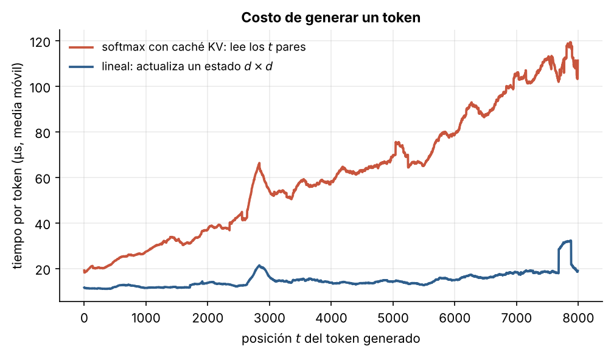
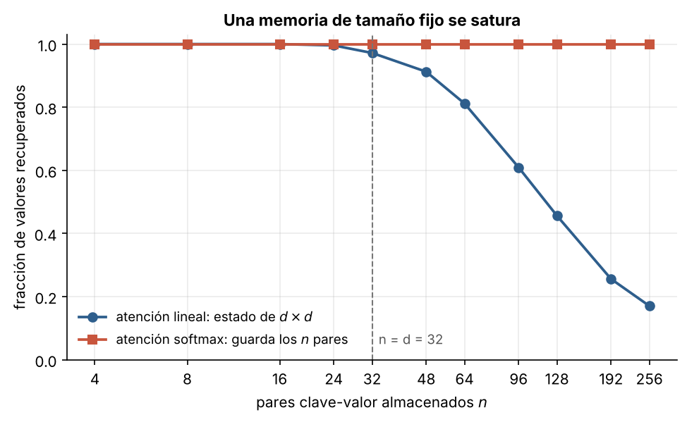

# 5.1 Atención lineal: el Transformer era una RNN

[Índice](../../README.md) · [Anterior: 4.3 Mezcla de expertos](../../capitulo-4/4.3-mezcla-de-expertos/) · [Siguiente: 5.2 Espacios de estados y S4](../5.2-espacios-de-estados-s4/)

## Objetivos

- Derivar la atención lineal y comprobar que su forma paralela y su forma recurrente son idénticas.
- Medir el costo por símbolo al generar con atención softmax y con atención lineal.
- Ver el límite de una memoria de tamaño fijo: cuántos pares clave-valor caben en un estado de $d \times d$.

## Contexto

En 2020, Angelos Katharopoulos y colaboradores publicaron un artículo con un título provocador: *Transformers are RNNs*. Mostraron que, si se reemplaza la exponencial del softmax por un producto de características, la atención se puede reescribir como una red recurrente con un estado de tamaño fijo. El entrenamiento sigue siendo paralelo y la generación pasa a costar lo mismo en cada paso, sin caché que crezca.

Un año después, Schlag, Irie y Schmidhuber señalaron que esto es formalmente equivalente a los **programadores de pesos rápidos** que Schmidhuber había propuesto en 1991-1992: una red lenta que, mediante productos externos clave-valor, escribe los pesos de otra red que cambia en cada paso. El estado de la atención lineal es literalmente una matriz de pesos que se reprograma con cada símbolo.

## Formalización

La atención causal con una similitud genérica es

$$
\mathbf o_t = \frac{\sum_{i \le t} \operatorname{sim}(\mathbf q_t, \mathbf k_i)\, \mathbf v_i}{\sum_{i \le t} \operatorname{sim}(\mathbf q_t, \mathbf k_i)}.
$$

Con $\operatorname{sim}(\mathbf q, \mathbf k) = \phi(\mathbf q)^\top \phi(\mathbf k)$, donde $\phi(x) = \operatorname{elu}(x) + 1 > 0$, la suma se puede reordenar:

$$
\mathbf o_t = \frac{S_t\, \phi(\mathbf q_t)}{\mathbf z_t^\top \phi(\mathbf q_t)}, \qquad
S_t = S_{t-1} + \mathbf v_t\, \phi(\mathbf k_t)^\top, \qquad
\mathbf z_t = \mathbf z_{t-1} + \phi(\mathbf k_t).
$$

El estado $S_t$ tiene tamaño $d_v \times d_k$, independiente de $t$. Generar un símbolo cuesta $O(d^2)$ en lugar de $O(t\,d)$.

**El problema.** La regla de escritura solo **suma**. Con claves de dimensión $d$, a lo sumo $d$ claves pueden ser ortogonales entre sí; a partir de ahí, cada lectura $S\mathbf k_i$ arrastra interferencia de todos los demás pares almacenados. La memoria se satura.

## Implementación

[`atencion_lineal.py`](atencion_lineal.py) contiene la atención lineal en sus dos formas, `lineal_paralela` y `lineal_recurrente`. Al ejecutarlo comprueba que dan el mismo resultado.

```bash
python capitulo-5/5.1-atencion-lineal/atencion_lineal.py
```

## Resultados

Las dos formas coinciden hasta $4.4 \times 10^{-16}$: son el mismo cálculo.

Al generar, el tiempo por símbolo de la atención softmax crece linealmente con la posición (111 µs a $t = 8192$), mientras que el de la atención lineal se mantiene en torno a 15-20 µs.



La capacidad muestra el precio. La atención softmax, que guarda todos los pares, recupera el 100 % en todos los casos. La memoria lineal de $32 \times 32$ recupera el 97 % con 32 pares, el 81 % con 64, el 46 % con 128 y el 17 % con 256.



## Lo que queda pendiente

En la práctica, la atención lineal de 2020 rendía claramente peor que la softmax en lenguaje. Dos ideas la harían competitiva: una recurrencia con una estructura más rica, que viene de la teoría de control ([5.2](../5.2-espacios-de-estados-s4/)), y una regla de escritura que no solo sume ([6.1](../../capitulo-6/6.1-regla-delta/)).

## Referencias

- Katharopoulos, A., Vyas, A., Pappas, N. y Fleuret, F. (2020). Transformers are RNNs: fast autoregressive transformers with linear attention. https://arxiv.org/abs/2006.16236
- Schlag, I., Irie, K. y Schmidhuber, J. (2021). Linear transformers are secretly fast weight programmers. https://arxiv.org/abs/2102.11174
- Schmidhuber, J. (1992). Learning to control fast-weight memories. *Neural Computation*, 4(1), 131–139. https://doi.org/10.1162/neco.1992.4.1.131
- Choromanski, K. et al. (2020). Rethinking attention with Performers. https://arxiv.org/abs/2009.14794
