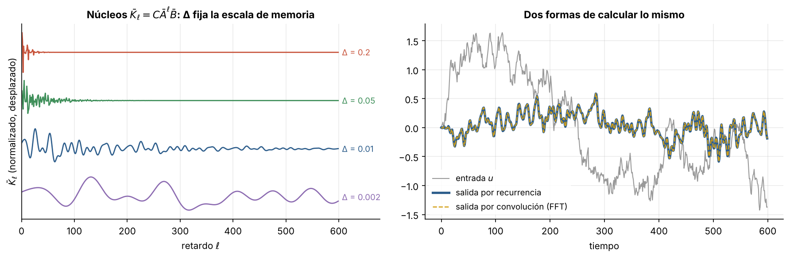
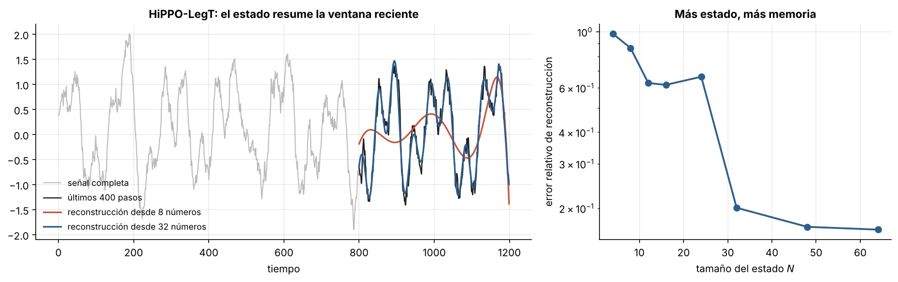

# 5.2 Modelos de espacio de estados: HiPPO y S4

[Índice](../../README.md) · [Anterior: 5.1 Atención lineal](../5.1-atencion-lineal/) · [Siguiente: 5.3 Mamba](../5.3-mamba/)

## Objetivos

- Discretizar un sistema lineal continuo y obtener una recurrencia.
- Comprobar que esa recurrencia equivale a una convolución con un núcleo fijo, que se calcula en paralelo con la FFT.
- Usar la matriz HiPPO-LegT para que un estado de pocos números resuma, de forma óptima, la historia reciente de una señal.

## Contexto

Los modelos de espacio de estados vienen de la teoría de control: el filtro de Kalman (1960) describe un sistema con un estado oculto que evoluciona según una ecuación diferencial lineal. Albert Gu y sus colaboradores en Stanford se preguntaron cómo elegir esa dinámica para que el estado funcionara como **memoria**.

HiPPO (2020) dio una respuesta con fundamento matemático: elegir la matriz $A$ de modo que el estado sea, en cada instante, la proyección de la historia de la entrada sobre una base de polinomios de Legendre. La memoria de largo plazo queda garantizada por diseño. S4 (Gu, Goel y Ré, 2021) encontró una parametrización estructurada que hacía el cálculo eficiente, y fue el primer modelo en resolver la tarea Path-X del banco de pruebas *Long Range Arena* (secuencias de 16 000 pasos), en la que todos los Transformers quedaban al nivel del azar. Siguió una familia de variantes: S4D, S5, H3, Hyena, RWKV, RetNet, LRU.

## Formalización

Un sistema lineal continuo con entrada escalar $u(t)$:

$$
\mathbf h'(t) = A\,\mathbf h(t) + B\,u(t), \qquad y(t) = C\,\mathbf h(t).
$$

Discretizar con paso $\Delta$ y retención de orden cero da

$$
\mathbf h_k = \bar A\, \mathbf h_{k-1} + \bar B\, u_k, \qquad y_k = C\,\mathbf h_k, \qquad
\bar A = e^{\Delta A}, \quad \bar B = A^{-1}(e^{\Delta A} - I)\, B.
$$

**Dualidad recurrencia-convolución.** Como $\bar A, \bar B, C$ no cambian con $k$ (el sistema es *lineal e invariante en el tiempo*), la recurrencia se desenrolla en una convolución:

$$
y = \bar K * u, \qquad \bar K = \big(C\bar B,\ C\bar A\bar B,\ C\bar A^2\bar B,\ \dots\big).
$$

Para entrenar se usa la convolución (paralela, $O(L \log L)$ con FFT); para generar, la recurrencia (costo constante por paso). Aquí se usa la versión diagonal S4D-Lin, con $A_n = -\tfrac12 + i\pi n$. El paso $\Delta$ fija la escala temporal: con $\Delta$ pequeño el núcleo decae despacio y la memoria es larga.

**HiPPO-LegT.** Para recordar una ventana de longitud $\theta$, la matriz

$$
A_{ij} = (2i+1)\begin{cases} -1 & i < j \\ (-1)^{i-j+1} & i \ge j \end{cases}, \qquad B_i = (2i+1)(-1)^i,
$$

con la dinámica $\theta\,\mathbf m'(t) = A\mathbf m(t) + B u(t)$, hace que $u(t - \theta') \approx \sum_i m_i(t)\, \tilde P_i(\theta'/\theta)$, donde $\tilde P_i$ son los polinomios de Legendre desplazados a $[0, 1]$ (Voelker, Kajić y Eliasmith, 2019; Gu et al., 2020). Un estado de $N$ números guarda los $N$ primeros coeficientes de la historia reciente.

## Implementación

[`espacios_de_estados.py`](espacios_de_estados.py) define `SSMDiagonal` (discretización ZOH, núcleo, forma recurrente y forma convolucional por FFT), `hippo_legt` y `reconstruir`, que comprime una ventana con HiPPO-LegT y la reconstruye. Al ejecutarlo verifica la dualidad recurrencia–convolución y mide el error de reconstrucción con 8 y 32 estados.

```bash
python capitulo-5/5.2-espacios-de-estados-s4/espacios_de_estados.py
```

## Resultados

La recurrencia y la convolución por FFT coinciden hasta $1.7 \times 10^{-15}$. Los núcleos muestran el papel de $\Delta$: con $\Delta = 0.2$ el núcleo se extingue en unas decenas de pasos; con $\Delta = 0.002$ sigue oscilando a los 600.



Con 32 números de estado, la reconstrucción de los últimos 400 pasos sigue la señal de cerca; con 8 solo captura la tendencia lenta. El error relativo baja de forma escalonada: 0.86 con 8 números, 0.62 con 16 y 0.20 con 32. El salto entre 24 y 32 corresponde a la componente rápida de la señal (periodo 47, más de ocho ciclos en la ventana), que necesita unos 30 polinomios para representarse. Lo que queda es el ruido de alta frecuencia.



## Lo que queda pendiente

Los modelos lineales e invariantes en el tiempo aplican **la misma dinámica a todos los símbolos**. No pueden decidir "esto es importante, guárdalo" o "esto es relleno, ignóralo". En lenguaje seguían por detrás de los Transformers, y Arora et al. (2023) mostraron que la mayor parte de la brecha se explicaba por una sola capacidad: recuperar el valor asociado a una clave vista antes en el contexto. Hacía falta selectividad ([5.3](../5.3-mamba/)).

## Referencias

- Gu, A., Dao, T., Ermon, S., Rudra, A. y Ré, C. (2020). HiPPO: recurrent memory with optimal polynomial projections. https://arxiv.org/abs/2008.07669
- Gu, A., Goel, K. y Ré, C. (2021). Efficiently modeling long sequences with structured state spaces. https://arxiv.org/abs/2111.00396
- Gu, A., Gupta, A., Goel, K. y Ré, C. (2022). On the parameterization and initialization of diagonal state space models. https://arxiv.org/abs/2206.11893
- Voelker, A., Kajić, I. y Eliasmith, C. (2019). Legendre memory units: continuous-time representation in recurrent neural networks. *NeurIPS*.
- Tay, Y. et al. (2020). Long Range Arena: a benchmark for efficient transformers. https://arxiv.org/abs/2011.04006
- Arora, S. et al. (2023). Zoology: measuring and improving recall in efficient language models. https://arxiv.org/abs/2312.04927
- Rush, S. y Karamcheti, S. The annotated S4. https://srush.github.io/annotated-s4/
