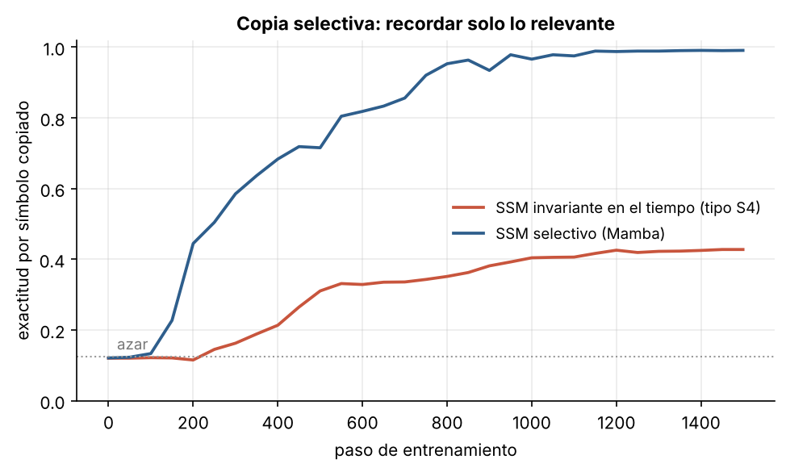
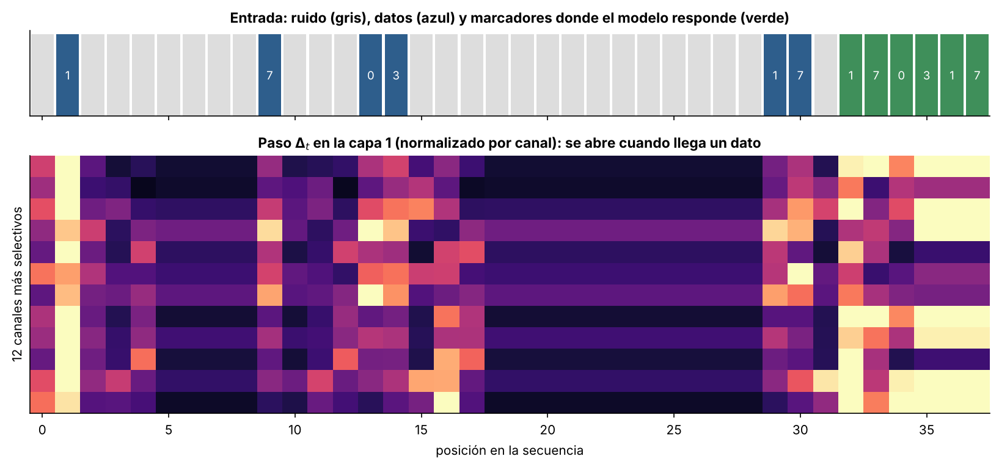

# 5.3 Mamba: espacios de estados selectivos

[Índice](../../README.md) · [Anterior: 5.2 Espacios de estados y S4](../5.2-espacios-de-estados-s4/) · [Siguiente: 5.4 Mamba-2 y la dualidad](../5.4-mamba2-dualidad/)

## Objetivos

- Implementar un bloque Mamba simplificado: proyección, convolución corta, espacio de estados selectivo y compuerta.
- Compararlo con el mismo bloque con parámetros invariantes en el tiempo (tipo S4) en la tarea de copia selectiva.
- Ver en el paso $\Delta_t$ cómo el modelo decide qué escribir en su memoria.

## Contexto

En diciembre de 2023, Albert Gu (Carnegie Mellon) y Tri Dao (Princeton) publicaron Mamba. La idea es hacer que los parámetros del espacio de estados **dependan de la entrada** en cada paso. Así el modelo puede abrir su memoria cuando llega algo importante y cerrarla ante el relleno, igual que las compuertas de la LSTM ([2.5](../../capitulo-2/2.5-lstm/)), pero dentro de un sistema lineal.

El precio es que el sistema deja de ser invariante en el tiempo y se pierde la forma convolucional de S4. Gu y Dao lo resolvieron con un algoritmo de barrido paralelo diseñado para la jerarquía de memoria de la GPU (la misma filosofía de FlashAttention, también de Dao). Según el artículo, un Mamba de 3000 millones de parámetros igualaba a Transformers del doble de tamaño, con unas cinco veces más rendimiento al generar y escalado lineal hasta secuencias de un millón de pasos.

## Formalización

Para cada canal $c$ de la entrada $\mathbf x_t$ y un estado de dimensión $N$:

$$
\Delta_t = \operatorname{softplus}(W_\Delta \mathbf x_t + \mathbf b_\Delta), \qquad
B_t = W_B\, \mathbf x_t, \qquad C_t = W_C\, \mathbf x_t,
$$

$$
\mathbf h_t = e^{\Delta_t A} \odot \mathbf h_{t-1} + \Delta_t\, B_t\, x_t, \qquad y_t = C_t^\top \mathbf h_t + D\, x_t,
$$

con $A$ diagonal y negativa. La intuición está en $\Delta_t$:

- $\Delta_t$ grande: $e^{\Delta_t A} \approx 0$, el estado se reinicia y se llena con la entrada actual.
- $\Delta_t$ pequeño: $e^{\Delta_t A} \approx 1$, el estado se conserva y la entrada se ignora.

El artículo de Mamba muestra que, en un caso particular ($N = 1$, $A = -1$, $B = 1$), esta recurrencia es exactamente la compuerta clásica $h_t = (1 - g_t)\, h_{t-1} + g_t\, x_t$.

El bloque completo: una proyección lineal produce dos ramas; una pasa por una convolución causal corta (núcleo 4), SiLU y el espacio de estados; la otra hace de compuerta multiplicativa con SiLU; una proyección final vuelve a la dimensión del modelo, con conexión residual. En la variante invariante en el tiempo, $\Delta$, $B$ y $C$ son parámetros fijos.

**Copia selectiva** (Gu y Dao, 2023). Una secuencia de 32 posiciones contiene 6 símbolos de datos en posiciones aleatorias; el resto es ruido. Después vienen 6 marcadores y el modelo debe escribir, en orden, los 6 datos. Como las posiciones cambian en cada ejemplo, una convolución o un núcleo fijo no saben dónde mirar: hay que decidir según el contenido.

## Implementación

[`mamba.py`](mamba.py) define `SSMSelectivo` (con o sin selectividad), `BloqueMamba` (convolución corta, SSM y compuerta SiLU), `Modelo` y la tarea de copia selectiva. Al ejecutarlo entrena el SSM invariante en el tiempo y el selectivo.

```bash
python capitulo-5/5.3-mamba/mamba.py
```

## Resultados

El modelo invariante en el tiempo (20 490 parámetros) se estanca en 43 % de exactitud. Mamba (28 682 parámetros) llega al 99 %.



La figura inferior muestra $\Delta_t$ en la primera capa para los 12 canales más selectivos, cada uno normalizado por su máximo. Las columnas brillantes coinciden con las posiciones de los datos: el paso se abre cuando llega algo que hay que guardar y se cierra durante el ruido. Promediado sobre todos los canales, $\Delta_t$ casi no distingue: 0.022 en los datos frente a 0.026 en el ruido. En los 12 canales de la figura, elegidos justamente por ese cociente, la diferencia es clara: 0.017 frente a 0.007, unas 2.4 veces más paso en los datos. La selectividad no está en todos los canales: el modelo la concentra en unos pocos, y además usa $B_t$ y $C_t$, que también dependen de la entrada.



## Lo que queda pendiente

- El barrido de Mamba no aprovecha las unidades de multiplicación de matrices de las GPU modernas, que concentran casi todo su poder de cómputo ([5.4](../5.4-mamba2-dualidad/)).
- El estado sigue siendo de tamaño fijo. Hay cosas que no caben: copiar cadenas largas o recordar muchos pares clave-valor (Jelassi et al., 2024; Arora et al., 2024). Eso lleva a los híbridos del capítulo 6.

## Referencias

- Gu, A. y Dao, T. (2023). Mamba: linear-time sequence modeling with selective state spaces. https://arxiv.org/abs/2312.00752
- Grootendorst, M. A visual guide to Mamba and state space models. https://www.maartengrootendorst.com/blog/mamba/
- Jelassi, S. et al. (2024). Repeat after me: transformers are better than state space models at copying. https://arxiv.org/abs/2402.01032
- Arora, S. et al. (2024). Simple linear attention language models balance the recall-throughput tradeoff. https://arxiv.org/abs/2402.18668
