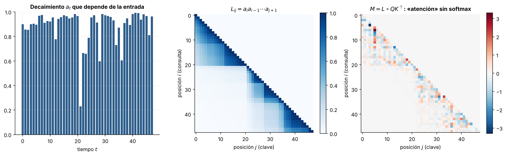
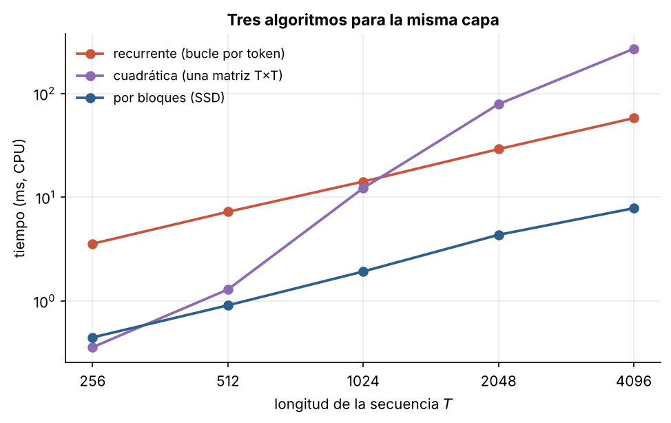

# 5.4 Mamba-2 y la dualidad entre espacios de estados y atención

[Índice](../../README.md) · [Anterior: 5.3 Mamba](../5.3-mamba/) · [Siguiente: 6.1 La regla delta](../../capitulo-6/6.1-regla-delta/)

## Objetivos

- Escribir la misma capa de tres formas: recurrente, cuadrática (como una atención enmascarada) y por bloques.
- Comprobar numéricamente que las tres coinciden y que la máscara es una matriz semiseparable.
- Comparar sus tiempos y entender por qué el algoritmo por bloques es el que se usa en la práctica.

## Contexto

Mamba tenía un problema práctico: su barrido no usa las unidades de multiplicación de matrices (*tensor cores*) de las GPU modernas. En *Transformers are SSMs* (2024), Tri Dao y Albert Gu restringieron la matriz de transición a un escalar por la identidad, $A_t = a_t I$. Con esa simplificación, Mamba-2 se puede escribir como una atención lineal con un factor de olvido que depende de la entrada, y también como una atención enmascarada sin softmax.

Los dos caminos del capítulo, atención lineal ([5.1](../5.1-atencion-lineal/)) y espacios de estados ([5.2](../5.2-espacios-de-estados-s4/)), convergen en una sola familia: **redes recurrentes lineales con estado matricial**. Los autores llamaron a esta equivalencia *dualidad de espacios de estados* (SSD). Mamba-2 entrena entre 2 y 8 veces más rápido que Mamba y admite estados mucho más grandes.

## Formalización

Renombrando $B_t \to \mathbf k_t$, $C_t \to \mathbf q_t$, $x_t \to \mathbf v_t$, la recurrencia de Mamba-2 es

$$
S_t = a_t\, S_{t-1} + \mathbf v_t \mathbf k_t^\top, \qquad \mathbf o_t = S_t\, \mathbf q_t, \qquad a_t \in (0, 1).
$$

Desenrollando, $\mathbf o_t = \sum_{s \le t} (a_t a_{t-1} \cdots a_{s+1})\,(\mathbf q_t^\top \mathbf k_s)\, \mathbf v_s$, que en forma matricial es

$$
O = (L \circ QK^\top)\, V, \qquad L_{ts} = \begin{cases} \prod_{r=s+1}^{t} a_r & s \le t \\ 0 & s > t. \end{cases}
$$

Es una atención causal sin softmax, con una máscara $L$ que decae. $L$ es **semiseparable de orden 1**: cualquier bloque bajo la diagonal tiene rango 1, porque $L_{ts} = \frac{\alpha_t}{\alpha_s}$ con $\alpha_t = \prod_{r \le t} a_r$.

**Algoritmo por bloques.** Se divide la secuencia en bloques de longitud $c$. Dentro de cada bloque se usa la forma cuadrática (productos de matrices, eficientes en hardware); entre bloques se pasa el estado $S$ con la recurrencia. El costo total es $O(T c d + (T/c)\, d^2)$: lineal en $T$ y construido sobre multiplicaciones de matrices.

## Implementación

[`dualidad.py`](dualidad.py) contiene los tres algoritmos para la misma capa: `recurrente`, `cuadratica` (con la máscara semiseparable) y `por_bloques`. Al ejecutarlo comprueba que coinciden.

```bash
python capitulo-5/5.4-mamba2-dualidad/dualidad.py
```

## Resultados

Las tres formas coinciden: la diferencia máxima es $2.8 \times 10^{-14}$ (cuadrática) y $4.2 \times 10^{-15}$ (por bloques). Los bloques bajo la diagonal de $L$ tienen rango 1, y los de $M = L \circ QK^\top$ tienen rango 16, igual a la dimensión de las claves.

La máscara $L$ muestra cómo un decaimiento pequeño corta la memoria: en $t = 21$, donde $a_t \approx 0.23$, la máscara se aclara de golpe y las posiciones posteriores casi no ven lo anterior. La matriz $M$ es la "atención" efectiva de la capa.



En CPU, la forma recurrente crece linealmente (58 ms para 4096 pasos) pero hace un paso de Python por símbolo; la cuadrática es rápida para secuencias cortas y explota después (270 ms para 4096); la de bloques es la más rápida en todas las longitudes (7.8 ms para 4096) porque combina lo mejor de ambas.



## Lo que queda pendiente

Mamba-2 olvida, pero olvida **todo por igual**: $a_t$ multiplica el estado completo. Si el modelo necesita reemplazar una sola asociación sin borrar las demás, la regla aditiva no ayuda. Volver a una idea de 1960 resolverá esto ([6.1](../../capitulo-6/6.1-regla-delta/)).

## Referencias

- Dao, T. y Gu, A. (2024). Transformers are SSMs: generalized models and efficient algorithms through structured state space duality. https://arxiv.org/abs/2405.21060
- Dao, T. y Gu, A. (2024). State space duality (Mamba-2), serie de blog. https://goombalab.github.io/blog/2024/mamba2-part1-model/
- Yang, S. et al. (2023). Gated linear attention transformers with hardware-efficient training. https://arxiv.org/abs/2312.06635
- Sun, Y. et al. (2023). Retentive network: a successor to transformer for large language models. https://arxiv.org/abs/2307.08621
