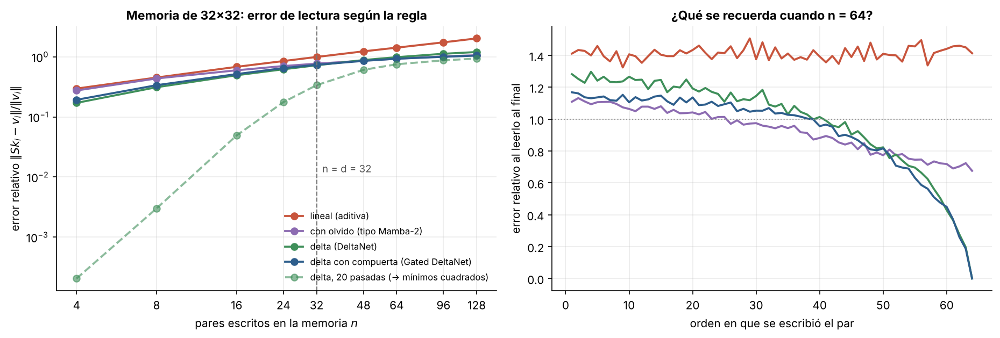
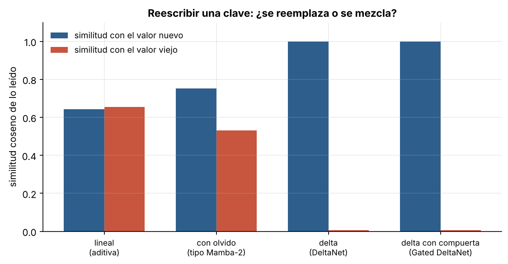

# 6.1 La regla delta vuelve: DeltaNet y Gated DeltaNet

[Índice](../../README.md) · [Anterior: 5.4 Mamba-2 y la dualidad](../../capitulo-5/5.4-mamba2-dualidad/) · [Siguiente: 6.2 Híbridos](../6.2-hibridos/)

## Objetivos

- Comprobar que la regla delta aplicada a una memoria matricial es un paso de descenso de gradiente, la misma ecuación de Adaline ([1.3](../../capitulo-1/1.3-adaline/)).
- Comparar cuatro reglas de escritura con el mismo estado de $32 \times 32$: aditiva, con olvido, delta y delta con compuerta.
- Ver qué pasa cuando se reescribe una clave que ya estaba en la memoria.

## Contexto

La atención lineal ([5.1](../../capitulo-5/5.1-atencion-lineal/)) solo suma: nunca borra ni corrige. Mamba-2 ([5.4](../../capitulo-5/5.4-mamba2-dualidad/)) olvida, pero olvida todo el estado por igual. Ninguna de las dos puede **reemplazar** una asociación concreta.

Schlag, Irie y Schmidhuber propusieron en 2021 la solución, citando explícitamente a Widrow y Hoff: antes de escribir un par $(\mathbf k, \mathbf v)$, leer qué devuelve la memoria para esa clave y escribir solo la corrección. El obstáculo era práctico: la recurrencia deja de ser un producto simple y no se sabía entrenarla en paralelo. Songlin Yang y colaboradores (NeurIPS 2024) encontraron un algoritmo por bloques basado en una representación clásica del álgebra lineal numérica (la representación WY de productos de Householder). *Gated DeltaNet* (Yang, Kautz y Hatamizadeh, ICLR 2025) combinó la regla delta con la compuerta de olvido de Mamba-2.

Gated DeltaNet es hoy la capa lineal de Qwen3-Next (2025) y de toda la familia Qwen3.5 (2026). Una variante con olvido por canal, Kimi Delta Attention, es la de Kimi Linear (2025). Una regla de 1960 está en el corazón de modelos con cientos de miles de millones de parámetros.

## Formalización

Las cuatro reglas, con memoria $S \in \mathbb R^{d_v \times d_k}$ y lectura $S\mathbf k$:

| Regla | Escritura |
|---|---|
| Aditiva (atención lineal) | $S_t = S_{t-1} + \mathbf v_t \mathbf k_t^\top$ |
| Con olvido (Mamba-2) | $S_t = \alpha_t S_{t-1} + \mathbf v_t \mathbf k_t^\top$ |
| Delta (DeltaNet) | $S_t = S_{t-1} + \beta_t (\mathbf v_t - S_{t-1}\mathbf k_t)\, \mathbf k_t^\top$ |
| Delta con compuerta (Gated DeltaNet) | $S_t = \alpha_t S_{t-1} + \beta_t (\mathbf v_t - \alpha_t S_{t-1}\mathbf k_t)\, \mathbf k_t^\top$ |

La regla delta es un paso de descenso de gradiente sobre la pérdida $\ell_t(S) = \tfrac12 \lVert S\mathbf k_t - \mathbf v_t \rVert^2$ con tasa $\beta_t$, porque $\nabla_S \ell_t = (S\mathbf k_t - \mathbf v_t)\,\mathbf k_t^\top$. Comparada con Adaline,

$$
\underbrace{\mathbf w \leftarrow \mathbf w + \eta\,(y - \mathbf w^\top \mathbf x)\,\mathbf x}_{\text{Widrow y Hoff, 1960}}
\qquad \longleftrightarrow \qquad
\underbrace{S_t = S_{t-1} + \beta_t\,(\mathbf v_t - S_{t-1}\mathbf k_t)\,\mathbf k_t^\top}_{\text{DeltaNet}}
$$

es la misma ecuación: las claves hacen de entradas, los valores de objetivos y la memoria de pesos. La memoria de la red es un pequeño Adaline que se entrena **mientras lee**. La regla aditiva, en cambio, es un paso de gradiente sobre $-\langle S\mathbf k_t, \mathbf v_t \rangle$, una pérdida que nunca se satura: por eso solo acumula.

Esta lectura se generaliza en el marco de *regresión en tiempo de prueba* (Wang, Shi y Fox, 2025): cada capa de secuencias memoriza ajustando una regresión de valores sobre claves y recupera evaluándola en la consulta. La atención softmax es una regresión no paramétrica que guarda todos los puntos; DeltaNet es un paso de descenso de gradiente en línea; TTT (Sun et al., 2024) y Titans (Behrouz et al., 2024) usan como memoria una red entera que se entrena durante la inferencia.

## Implementación

[`regla_delta.py`](regla_delta.py) define las cuatro reglas de escritura (lineal, con olvido, delta y delta con compuerta) y `escribir`, que las aplica a una secuencia de pares. Al ejecutarlo escribe 12 pares, reescribe la primera clave con un valor nuevo y mide qué se lee.

```bash
python capitulo-6/6.1-regla-delta/regla_delta.py
```

## Resultados

La verificación da diferencia cero: la regla delta **es** un paso de descenso de gradiente.

Con pocos pares, la regla delta tiene el menor error de lectura (0.17 con 4 pares frente a 0.30 de la aditiva). Con la regla aditiva el error crece sin límite: con 128 pares vale 2.0, peor que no recordar nada. Con olvido o con regla delta el error se estabiliza cerca de 1. Aplicar la regla delta varias veces sobre los mismos pares (como haría un optimizador con más pasos) baja el error a prácticamente cero mientras $n$ sea pequeño frente a $d$.

El panel derecho muestra **qué** recuerda cada regla cuando se escriben el doble de pares que dimensiones. La aditiva lo mezcla todo: cada par tiene un error de 1.4. Las reglas delta recuerdan casi perfectamente los pares recientes y olvidan los antiguos, que es el comportamiento útil para una memoria de trabajo.



En la sobrescritura, la diferencia es total. La regla aditiva devuelve una mezcla del valor viejo y el nuevo (similitud 0.65 y 0.64 con cada uno). Con olvido, la mezcla se inclina hacia el nuevo pero el viejo sigue ahí (0.75 y 0.53). Las reglas delta devuelven el valor nuevo (1.00) y borran el viejo (0.01).



## Lo que queda pendiente

Por buena que sea la regla de escritura, la memoria sigue siendo de tamaño fijo. ¿Cuánta atención exacta hace falta conservar? ([6.2](../6.2-hibridos/)).

## Referencias

- Widrow, B. y Hoff, M. E. (1960). Adaptive switching circuits. *IRE WESCON Convention Record*, 4, 96–104.
- Schlag, I., Irie, K. y Schmidhuber, J. (2021). Linear transformers are secretly fast weight programmers. https://arxiv.org/abs/2102.11174
- Yang, S., Wang, B., Zhang, Y., Shen, Y. y Kim, Y. (2024). Parallelizing linear transformers with the delta rule over sequence length. https://arxiv.org/abs/2406.06484
- Yang, S., Kautz, J. y Hatamizadeh, A. (2024). Gated delta networks: improving Mamba2 with delta rule. https://arxiv.org/abs/2412.06464
- Kimi Team (2025). Kimi Linear: an expressive, efficient attention architecture. https://arxiv.org/abs/2510.26692
- Wang, K. A., Shi, J. y Fox, E. B. (2025). Test-time regression: a unifying framework for designing sequence models with associative memory. https://arxiv.org/abs/2501.12352
- Sun, Y. et al. (2024). Learning to (learn at test time): RNNs with expressive hidden states. https://arxiv.org/abs/2407.04620
- Behrouz, A., Zhong, P. y Mirrokni, V. (2024). Titans: learning to memorize at test time. https://arxiv.org/abs/2501.00663
- Yang, S. (2024). DeltaNet explained. https://sustcsonglin.github.io/blog/2024/deltanet-1/
