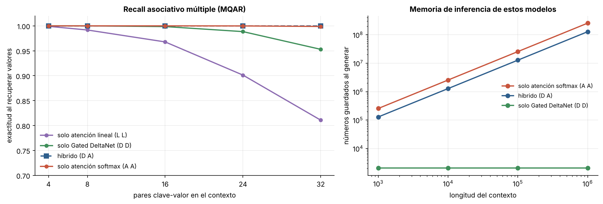

# 6.2 Híbridos: cuánta atención hace falta

[Índice](../../README.md) · [Anterior: 6.1 La regla delta](../6.1-regla-delta/) · [Siguiente: 6.3 Estados complejos](../6.3-estados-complejos/)

## Objetivos

- Implementar tres mezcladores de secuencia intercambiables: atención softmax, atención lineal y Gated DeltaNet.
- Entrenar modelos de dos capas en la tarea de recall asociativo múltiple (MQAR) con distintas combinaciones.
- Comparar la capacidad de recuperación con la memoria que cada diseño necesita al generar.

## Contexto

En 2024 se consolidó una conclusión: ni la "base de datos" (atención, que guarda todo) ni el "cerebro" (recurrencia, que comprime) dominan al otro. Arora y colaboradores mostraron en *Zoology* (2023) que la brecha entre ambos en lenguaje se explicaba sobre todo por el recall asociativo, y en *Based* (2024) describieron un compromiso directo entre el tamaño del estado y la capacidad de recuperar información exacta del contexto.

La respuesta de la industria fueron los **híbridos**: muchas capas recurrentes baratas y unas pocas capas de atención que cubren el recall exacto. Solo las capas de atención guardan caché KV, así que la memoria de inferencia se divide por la proporción de capas lineales. Algunos ejemplos:

| Fecha | Modelo | Capa lineal | Proporción lineal : atención |
|---|---|---|---|
| mar 2024 | Jamba (AI21) | Mamba | 7 : 1 |
| 2025 | MiniMax-01 / M1 | atención lineal (*lightning*) | 7 : 1 |
| sep 2025 | Qwen3-Next (Alibaba) | Gated DeltaNet | 3 : 1 |
| oct 2025 | IBM Granite 4.0 | Mamba-2 | 9 : 1 |
| oct 2025 | Kimi Linear (Moonshot AI) | Kimi Delta Attention | 3 : 1 |
| dic 2025 | NVIDIA Nemotron 3 | Mamba-2 | mayoría Mamba-2 y MoE, pocas capas de atención |
| feb 2026 | Qwen3.5 (Alibaba) | Gated DeltaNet | 3 : 1 |

No todo apunta en la misma dirección. MiniMax volvió a la atención completa en M2 (octubre de 2025) tras observar que los híbridos rendían igual en los rankings habituales pero fallaban en razonamiento de varios pasos a gran escala, y que la infraestructura para atención lineal era inmadura. Un análisis sistemático (Wang et al., 2025) concluyó que es el recall, y no la perplejidad, lo que determina la proporción adecuada, y que las compuertas de olvido son imprescindibles.

## Formalización

**MQAR** (*multi-query associative recall*, Arora et al., 2023). La secuencia contiene $n$ pares clave-valor seguidos de las $n$ claves en otro orden; en la posición de cada clave consultada, el modelo debe predecir su valor:

$$
k_1\ v_1\ k_2\ v_2\ \cdots\ k_n\ v_n \ \Big|\ k_{\pi(1)} \to v_{\pi(1)}\ \ k_{\pi(2)} \to v_{\pi(2)}\ \cdots
$$

Hay 64 claves y 64 valores posibles. Una capa de atención puede resolverlo guardando todos los pares. Una capa recurrente debe escribirlos en un estado de tamaño fijo, aquí 4 cabezas de $16 \times 16$ (1024 números por capa).

**Gated DeltaNet** usa la regla de [6.1](../6.1-regla-delta/) con $\alpha_t$ y $\beta_t$ calculados a partir de la entrada y claves normalizadas:

$$
S_t = \alpha_t S_{t-1} + \beta_t\,(\mathbf v_t - \alpha_t S_{t-1}\mathbf k_t)\,\mathbf k_t^\top, \qquad \mathbf o_t = S_t \mathbf q_t.
$$

Antes de las proyecciones $\mathbf q, \mathbf k, \mathbf v$, las capas lineales aplican una **convolución causal corta** (núcleo 3), como hacen Mamba, Based y Gated DeltaNet. Sin ella, la posición del valor no sabe cuál era la clave anterior y la tarea no se aprende con una sola capa.

## Implementación

[`hibridos.py`](hibridos.py) define tres mezcladores intercambiables (`AtencionSoftmax`, `AtencionLineal` y `GatedDeltaNet`), la convolución corta, `Bloque` y `Modelo`, que recibe el patrón de capas como cadena (`"LL"`, `"DD"`, `"DA"`, `"AA"`), además de la tarea MQAR. Al ejecutarlo entrena el modelo de atención lineal y el híbrido.

```bash
python capitulo-6/6.2-hibridos/hibridos.py
```

## Resultados

| Modelo | 4 pares | 8 | 16 | 24 | 32 |
|---|---|---|---|---|---|
| Solo atención lineal (L L) | 1.00 | 0.99 | 0.97 | 0.90 | 0.81 |
| Solo Gated DeltaNet (D D) | 1.00 | 1.00 | 1.00 | 0.99 | 0.95 |
| Híbrido (D A) | 1.00 | 1.00 | 1.00 | 1.00 | 1.00 |
| Solo atención softmax (A A) | 1.00 | 1.00 | 1.00 | 1.00 | 1.00 |

Con pocos pares todos resuelven la tarea. A medida que crecen, la atención lineal pierde exactitud antes (81 % con 32 pares) que Gated DeltaNet (95 %), con el mismo tamaño de estado: la regla de escritura importa. Una sola capa de atención en el híbrido basta para recuperar el 100 %.

A la derecha, la memoria que cada modelo necesita al generar. La de la atención crece con el contexto; la del híbrido también, pero a la mitad; la de Gated DeltaNet es constante. En modelos reales, con proporciones de 3:1 a 9:1, el ahorro es mucho mayor que aquí.



## Lo que queda pendiente

Los híbridos resuelven el recall, pero las capas lineales tienen además un límite de expresividad propio, independiente de la memoria: con transiciones reales y positivas no pueden ni siquiera contar la paridad de una secuencia ([6.3](../6.3-estados-complejos/)).

## Referencias

- Arora, S. et al. (2023). Zoology: measuring and improving recall in efficient language models. https://arxiv.org/abs/2312.04927
- Arora, S. et al. (2024). Simple linear attention language models balance the recall-throughput tradeoff. https://arxiv.org/abs/2402.18668
- Lieber, O. et al. (2024). Jamba: a hybrid transformer-Mamba language model. https://arxiv.org/abs/2403.19887
- MiniMax (2025). MiniMax-01: scaling foundation models with lightning attention. https://arxiv.org/abs/2501.08313
- MiniMax (2025). Why did M2 end up as a full attention model? https://huggingface.co/blog/MiniMax-AI/why-did-m2-end-up-as-a-full-attention-model
- Wang, D. et al. (2025). A systematic analysis of hybrid linear attention. https://arxiv.org/abs/2507.06457
- Kimi Team (2025). Kimi Linear: an expressive, efficient attention architecture. https://arxiv.org/abs/2510.26692
- NVIDIA (2025). NVIDIA Nemotron 3: efficient and open intelligence. https://arxiv.org/abs/2512.20856
- IBM (2025). IBM Granite 4.0: hyper-efficient, high performance hybrid models for enterprise. https://www.ibm.com/new/announcements/ibm-granite-4-0-hyper-efficient-high-performance-hybrid-models
- Labonne, M. (2026). Qwen3.5: nobody agrees on attention anymore. https://huggingface.co/blog/mlabonne/qwen35
- Raschka, S. Beyond standard LLMs. https://magazine.sebastianraschka.com/p/beyond-standard-llms
