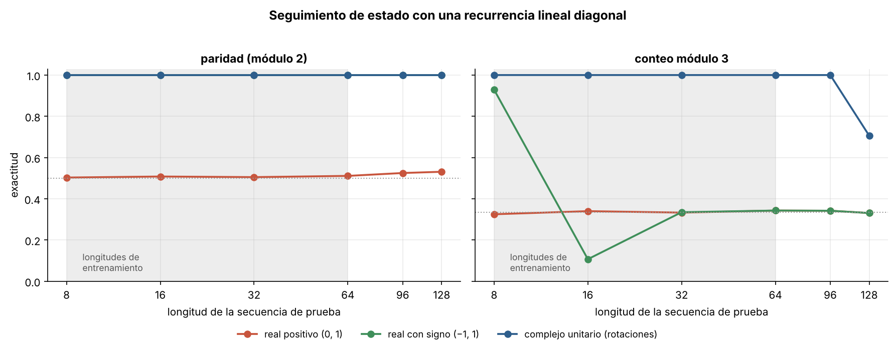
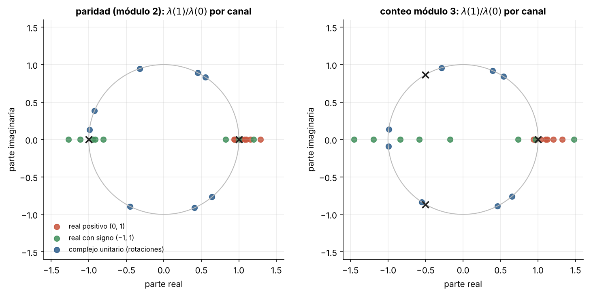

# 6.3 Estados complejos y seguimiento de estado: la idea de Mamba-3

[Índice](../../README.md) · [Anterior: 6.2 Híbridos](../6.2-hibridos/) · [Volver al inicio](../../README.md)

## Objetivos

- Entrenar una recurrencia lineal diagonal en dos tareas de seguimiento de estado: la paridad y el conteo módulo 3.
- Comparar tres tipos de transición: real positiva, real con signo y rotación compleja.
- Ver por qué Mamba-3 introduce estados de valores complejos.

## Contexto

La historia empezó con la paridad: Minsky y Papert (1969) mostraron que un perceptrón de una capa no puede calcular XOR, que es la paridad de dos bits ([1.4](../../capitulo-1/1.4-xor/)). Más de cincuenta años después, la paridad volvió a ser una prueba de expresividad.

Grazzi y colaboradores (ICLR 2025) demostraron que las redes recurrentes lineales cuyos valores propios de transición son reales y positivos, como Mamba y Mamba-2, **no pueden** calcular la paridad de una secuencia de longitud arbitraria, y que hacen falta valores propios negativos para la paridad y complejos para contar módulo 3. Las LSTM no lineales sí podían; la linealidad que permite paralelizar el entrenamiento tiene un costo.

Mamba-3 (Lahoti, Li, Chen, Wang, Bick, Kolter, Dao y Gu, ICLR 2026) responde con tres cambios: una discretización más precisa, una formulación de múltiples entradas y salidas para aprovechar mejor el hardware al generar y, lo que estudia esta sección, una transición de **valores complejos**, implementada como una rotación dependiente de la entrada (una variante de RoPE).

## Formalización

El modelo es la recurrencia lineal más simple posible, con una transición que depende del bit de entrada $x_t \in \{0, 1\}$:

$$
\mathbf h_t = \boldsymbol\lambda(x_t) \odot \mathbf h_{t-1}, \qquad \hat y = \operatorname{MLP}\big(\operatorname{Re}\,\mathbf h_T,\ \operatorname{Im}\,\mathbf h_T\big),
$$

con 8 canales y tres familias para $\boldsymbol\lambda$:

| Variante | Transición | Rango |
|---|---|---|
| Real positiva (como Mamba y Mamba-2) | $\sigma(m)$ | $(0, 1)$ |
| Real con signo | $\tanh(m)$ | $(-1, 1)$ |
| Compleja unitaria (como Mamba-3) | $e^{i\pi\tanh(a)}$ | círculo unitario |

Tras $T$ pasos, $\mathbf h_T = \mathbf h_0 \prod_t \boldsymbol\lambda(x_t)$. Para la paridad basta $\lambda(1) = -1$ y $\lambda(0) = 1$: cada uno cambia el signo. Para contar módulo 3 hace falta $\lambda(1) = e^{2\pi i/3}$: cada uno rota 120°. Con valores reales positivos, el producto solo puede achicarse o crecer de forma monótona con el número de unos; no hay forma de que vuelva al punto de partida, que es lo que exige contar de forma cíclica.

## Implementación

[`estados_complejos.py`](estados_complejos.py) define `RecurrenciaDiagonal`, con transición real positiva, real con signo o compleja unitaria, y el entrenamiento con longitudes variables. Al ejecutarlo entrena las tres variantes en el conteo módulo 3 y las evalúa con $T = 96$, más allá de las longitudes de entrenamiento.

```bash
python capitulo-6/6.3-estados-complejos/estados_complejos.py
```

## Resultados

| Tarea | Real positiva | Real con signo | Compleja unitaria |
|---|---|---|---|
| Paridad | 50 % (azar) en todas las longitudes | 100 % hasta 128 | 100 % hasta 128 |
| Conteo módulo 3 | 33 % (azar) | 93 % con 8, azar desde 16 | 100 % hasta 96, 71 % con 128 |

La predicción teórica se cumple en las dos tareas. La transición positiva no aprende ninguna. La transición con signo resuelve la paridad pero no el conteo módulo 3. La rotación compleja resuelve ambas, y generaliza más allá de las longitudes de entrenamiento (zona gris), aunque con 128 pasos los pequeños errores en el ángulo aprendido empiezan a acumularse.



La figura siguiente muestra, para cada canal, la transición relativa $\lambda(1)/\lambda(0)$: cuánto cambia el estado un 1 respecto a un 0. En la paridad, los canales con signo y algunos complejos se sitúan cerca de $-1$. En el conteo módulo 3, al menos un canal complejo se acerca a la raíz cúbica de la unidad $e^{-2\pi i/3}$. Los reales positivos solo pueden estar sobre el semieje positivo. La red reparte la solución entre varios canales; basta con que uno tenga la rotación correcta.



## Lo que queda pendiente

Este capítulo cierra el recorrido en el estado actual de la investigación. Las preguntas abiertas en noviembre de 2026 incluyen cuánta atención exacta hace falta en un híbrido y si debe decidirse por capa o por símbolo, si el aprendizaje continuo (memorias que siguen aprendiendo después del despliegue, como Titans o *Nested Learning*) llegará a los modelos de producción, y si la generación seguirá siendo autorregresiva.

## Referencias

- Grazzi, R. et al. (2025). Unlocking state-tracking in linear RNNs through negative eigenvalues. ICLR 2025. https://arxiv.org/abs/2411.12537
- Lahoti, A., Li, K. Y., Chen, B., Wang, C., Bick, A., Kolter, J. Z., Dao, T. y Gu, A. (2026). Mamba-3: improved sequence modeling using state space principles. ICLR 2026. https://arxiv.org/abs/2603.15569
- Princeton Language and Intelligence (2026). Blog de Mamba-3. https://pli.princeton.edu/blog/2026/mamba-3-improved-sequence-modeling-using-state-space-principles
- Merrill, W., Petty, J. y Sabharwal, A. (2024). The illusion of state in state-space models. https://arxiv.org/abs/2404.08819
- Su, J. et al. (2021). RoFormer: enhanced transformer with rotary position embedding. https://arxiv.org/abs/2104.09864
- Minsky, M. y Papert, S. (1969). *Perceptrons*. MIT Press.
